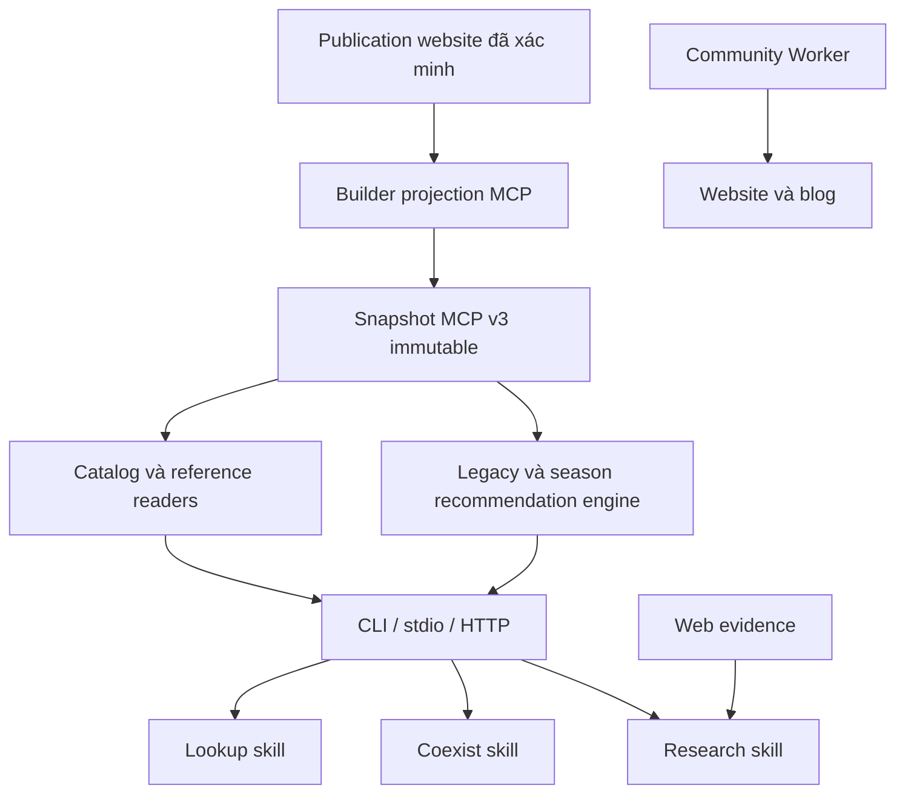

# Kiến trúc MCP và skill đề xuất

Trạng thái: thiết kế để triển khai; tên tool mới và field mới bên dưới **chưa tồn tại** trong runtime.

**Bổ sung 2026-09-27, chỉnh 2026-10-07:** [thiết kế skill–MCP và learning](skill-mcp-learning-design.md) bổ sung knowledge/learning. **Bề mặt tool chốt là P\* — 7 tool** ([debate tool-surface](reports/debate-tool-surface.md)), thay mốc 12/14 tool trước đó; user bỏ ràng buộc giữ 8 tool cũ. `tqccl_search_rules` chỉ đăng ký khi chạm ngưỡng ở phase 2.

## 1. Quyết định chính

Thay bề mặt MCP hiện tại bằng 7 tool gộp theo việc agent cần làm, đọc được toàn bộ dữ liệu game công khai của website (7 nhóm Tra cứu, ba họ đội tham khảo) và ghép đội bằng đúng adapter của trang Gợi ý kho. Cutover một lần, không giữ alias 8 tool cũ.

Skill chỉ điều phối ý định, scope, xác nhận và cách diễn giải bằng chứng. Validation, canonical identity, filtering, pagination và tính toán nằm trong code có test.

### Ba lựa chọn đã cân nhắc

| Lựa chọn | Đánh giá |
|---|---|
| Chỉ sửa prompt/skill | Không giải quyết phần corpus MCP không truy cập được; tăng nguy cơ agent tự đọc nhầm raw/private |
| Viết server mới, thay toàn bộ tools | Tăng migration và release cost, bỏ phí normalization/binding/parity tests đã có |
| Mở rộng server, thêm read model từ publication | **Chọn**: dùng lại phần đã kiểm chứng và bổ sung đúng khoảng trống |

## 2. Bốn trục ngữ cảnh phải tách riêng

| Trục | Ý nghĩa | Quy tắc |
|---|---|---|
| `sourceSeasonId` | Mùa được nhà cung cấp nguồn gán cho bản ghi | Dùng lọc đội chuẩn; lấy từ seasons publication |
| `seasonContext` | `scenarioId` + `rulesetId` đã review | Chỉ cho chấm theo luật khi có ruleset; hiện hai scenario đều `rulesets: []`. `tqccl_recommend_teams` không nhận field này |
| `locale` | `vi` hoặc `zh`, mặc định `vi` | Chỉ điều khiển hiển thị/link; không suy server |
| server/region | Phạm vi áp dụng game mà user hỏi | Ghi rõ known/unknown trong skill; không chuyển CN sang Global bằng ngôn ngữ |

Build team chọn **mùa nguồn** theo [season design](season-resolution-design.md) như trang Gợi ý kho: user chỉ định → đã xác nhận → `defaultSourceSeasonId` của bản publish Recommended (quyết định user 2026-10-07). Ghép đội theo nguồn + kho (`basis:"source-reference-fit"`) không cần ruleset nhưng phải gắn `rulesetVerified:false`; chấm theo luật chỉ mở khi `rulesetScoringReady`.

## 3. Snapshot và nguồn dữ liệu

### 3.1 Giữ hợp đồng đang có

- V1/V2 vẫn đọc được. Sáu legacy artifacts và năm season sidecars giữ định danh, lọc public và validation hiện tại.
- Giữ `releaseId` full SHA-256; digest workflow/binding vẫn dùng encoding hiện hành.
- `publicSnapshotView` tiếp tục loại dữ liệu bị ẩn cùng liên kết/evidence chỉ phục vụ dữ liệu đó.
- Corpus legacy (166 đội engine) vẫn đọc được qua `collection:"engine"` trong `tqccl_find_teams`/`tqccl_get_team`; tên tool cũ bị xoá ở cutover.

### 3.2 Thêm manifest v3 cho publication

Builder chạy ở Node đọc **cùng các byte đã được website verifier chấp nhận**:

1. Lookup manifest + heroes/tactics/catalog qua validator hiện có.
2. Recommended `current.json` + manifest + exact file inventory; không chọn thư mục mới nhất theo mtime.
3. Website display snapshot: đối chiếu source hashes và recommended pin trước khi áp lớp dịch.
4. Khai hoang từ public bytes đã pin và route catalog/handle ledger tương ứng.

Tạo read model có allowlist field, không copy thư mục `data/` hoặc private `data/sgsdeck/`. Projection giữ ID nguồn, slot/holder, source score, link đã được phép public, translation status và cảnh báo. Website-public không tự động đồng nghĩa được phát tán mọi field private đầu vào: projection chỉ lấy field đang public và cần cho tool.

V3 gồm legacy/season artifacts cộng:

- `catalog-entities`: bảy nhóm Tra cứu theo route `/tra-cuu/{tuong,chien-phap,trang-bi,quan-su,cai-tao-binh-chung,cong-trinh,binh-thu}/` — nguồn `heroes-dict`, `tactics`, `lookup-catalog` (trang bị, quân sư, cải tạo, công trình; specials thuộc trang bị) và `books-dict`; nested specials/options/levels có schema và pagination riêng ở detail.
- `reference-registry`: source season, category, available collection và label.
- `reference-team-index`: summary của `recommended`, `other`, `khaihoang`.
- `reference-team-details`: cấu hình/biến thể/guide đầy đủ theo ID, phân shard nếu vượt giới hạn artifact.
- `public-routes`: mapping ID → đường dẫn đã build được, gồm locale.

Manifest ghi upstream generation/hash và digest từng artifact/shard. Inventory v3 được suy duy nhất từ manifest đã validate; tên shard có grammar cố định, không nhận đường dẫn tùy ý hoặc traversal. Mỗi artifact tối đa 8 MiB như gate hiện hành. Bước 1 phải đo byte thực, chọn số shard deterministic và lưu vào contract trước khi code reader; không tăng trần vì builder chưa chia nhỏ.

Validation hash và shape ở ingress; Worker chỉ đọc immutable Assets. Không import `node:fs`, Astro, DOM hoặc browser globals vào Worker. Shared pure validators/projectors có thể tách từ owner hiện có khi cần, tránh kéo toàn UI vào source graph.

### 3.3 Identity và chuyển version

- V3 `releaseId` bao phủ toàn bộ bytes projection + upstream pins. Thay nội dung/locale/route làm đổi release; `workflowVersion` vẫn kết hợp release + semantic build.
- Cursor bind tool, query/filter chuẩn hóa, locale, ordering và workflowVersion; replay sang tool/filter/version khác bị từ chối.
- Bổ sung capabilities cho catalog/reference/locale và available collections. Không công bố đầy đủ 1.366 records trong version response; registry dài lấy qua browse response có giới hạn.
- `tqccl_get_playbook` thay `get_data_version`: trả version, capabilities và registry có giới hạn. Đổi bề mặt tool phải refresh discovery trên consumer (Dewee: reconnect, xem [dewee#887](https://github.com/nextlevelbuilder/dewee/issues/887)); endpoint release cũ là rollback path.
- Snapshot v1/v2 trả `CAPABILITY_UNAVAILABLE` cho phần catalog/reference; không trả mảng rỗng gây hiểu nhầm là không có dữ liệu.

## 4. Tool surface mục tiêu: 7 tools (P\*)

| Tool | Thay cho | Input chính | Output chính |
|---|---|---|---|
| `tqccl_get_playbook` | `get_data_version` + playbook | `intent`, `stage?`, season selection, `locale?` | versions, capabilities, `seasonSelection`, readiness `referenceFitReady`/`rulesetScoringReady`, required rules + guidance, next-step tool names |
| `tqccl_search` | `search` + `search_catalog` | `query`, `kinds?` ⊆ {hero, tactic, equipment, advisor, troopMod, building, book, team}, `limit?`, `cursor?` | `items[{entityId,kind,displayName,matchedTerm?,pagePath}]` (+`collection`/`configId` cho team), pagination |
| `tqccl_get_entity` | `get_catalog_entity` | `entityId`, `section?`, `limit?`, `cursor?` | hồ sơ khớp `/tra-cuu/<nhóm>/` (vi/zh); nested specials/options/levels phân trang; `omittedCounts` |
| `tqccl_find_teams` | `match_team` + `browse_reference_teams` | `collection` ∈ {recommended, other, khaihoang, engine}, `sourceSeasonId?`, `sourceCategoryId?`, `query?`, `heroes?[{canonicalId, tacticIds[]}]`, `minHeroes?`, `limit?`, `cursor?` | summary, source scope, tier/score nguyên bản, selector `reference`, `pagePath` |
| `tqccl_get_team` | `get_team` + `get_reference_team` + nhánh đọc `suggest_replacements` | `reference:{collection, …}`, `section?`, `cursor?` | cấu hình/biến thể/guide, holder/slot/books, `alternatives`/`tacticRefs` theo ô (chiến pháp thay thế nguồn), `sourceScore` chỉ cho cấu hình gốc, `CONFIG_AMBIGUOUS` kèm choices |
| `tqccl_normalize_entities` | giữ | observations | `canonicalState`, `confirmationBinding`, ambiguity/reviewRequired |
| `tqccl_recommend_teams` | `recommend_team` + `recommend_coexist` + `recommend_from_reference` + nhánh món bù `suggest_replacements` | `canonicalState`, `confirmationBinding`, `sourceSeasonId`, `lockedTeams?`, `maxTeams?`, `mode?`, `tacticOverrides?`, `fullBox?` | `portfolioTeams`, `blockedStrongTeams` với `substitutes[]` theo kho, nhãn "đã thay", `legacyUsed`, `basis:"source-reference-fit"`, `rulesetVerified:false` |

Selector `reference` (lồng trong `properties`):

- Recommended: `{collection:"recommended", sourceConfigId}`.
- Other: `{collection:"other", legacyTeamId, legacyVariantId}`; đọc **admitted variant** trong publication, không toàn raw legacy.
- Khai hoang: `{collection:"khaihoang", khaiHoangTeamId}`; guides/chamSuTeams nằm trong context của đúng record khi có liên kết rõ, không ghép tên suy đoán.
- Engine: `{collection:"engine", teamId, configId?}`.

`sourceSeasonId`/category chỉ nhận khi collection có mapping tương ứng; Khai hoang không có registry tương đương thì trả `REFERENCE_SCOPE_INVALID`. Search hỗ trợ tên Việt/Hán/Hán-Việt/alias từ dữ liệu hiện có; không fuzzy match âm thầm đổi identity.

### `tqccl_recommend_teams`

- Gọi đúng `recommendRoster` của `js/roster-season-candidates.js` như trang Gợi ý kho (`js/roster-recommend-ui.js:544-556`); không viết engine thứ hai. Không nhận `seasonContext`: engine ném `Invalid seasonal candidate identity` với team từ `buildSeasonCandidates` (`team-recommend-engine.js:527-533`).
- `sourceScore` chỉ cho cấu hình gốc chưa đổi ô; không chuyển điểm sang biến thể.
- Món bù theo kho (`suggestTacticSubstitutes`) thuộc output này; chiến pháp thay thế ghi trong nguồn thuộc `tqccl_get_team`.
- Chỉ đăng ký sau khi sửa lỗi audit adapter và đưa `roster-season-candidates.js` + deps vào `semanticFiles` ([phase 1](phase-01-mcp-publication.md)).

### Quy tắc hợp đồng

- **Mô tả tool:** câu "khi dùng / trả về / lỗi" nằm trong 200 byte đầu — phần Dewee hiện trong danh sách tóm tắt system prompt; định nghĩa tool gửi cho LLM vẫn mang mô tả đầy đủ. Tham số mô tả ở `describe` từng field.
- **Discriminator** (`kinds`, `collection`, `reference`) nằm trong `inputSchema.properties`; không `oneOf`/`anyOf`/`allOf` ở gốc (mất ở `mcp-go` và bị OpenAI strict từ chối). Không dùng `$ref`/`$defs` trong input schema cho tới khi [dewee#888](https://github.com/nextlevelbuilder/dewee/issues/888) được sửa. Validate nhánh ở server, lỗi `INVALID_REQUEST` + `fields`.
- **`expectedWorkflowVersion`:** optional ở tool đọc không trạng thái; nếu gửi thì honor (`WORKFLOW_VERSION_CHANGED` khi lệch); bắt buộc khi có `cursor` hoặc `confirmationBinding`. Mọi result trả `workflowVersion`.
- Request strict; query tối đa 256 ký tự, limit mặc định 20/tối đa 50, cursor tối đa 2.048 ký tự; ID tối đa 256 ký tự, phải khớp record trong snapshot.

### Envelope, bounds và lỗi

- Thành công: `releaseId`, `dataVersion`, `workflowVersion`, `provenance`, `warnings`, `truncated`; thêm `items` hoặc `entity`/`team` theo tool, `nextCursor` khi còn dữ liệu.
- Reference có `purpose:"reference"`; applicability lấy bằng chứng thật hoặc `unknown`, không default VN/Global. Claim status do skill đánh giá.
- JSON schema hữu hạn theo kind, tránh `record<string,unknown>`/`unknown`.
- Structured output dưới 40.000 ký tự (giới hạn Dewee) và tối đa 64 KiB/result; cắt theo records/sections, giữ JSON hợp lệ, ghi `omittedCounts`. Detail dùng `section`/cursor thay `boundedJson`; không lược slot trọng yếu rồi trình bày là cấu hình đầy đủ.
- Lỗi: giữ lỗi hiện có; thêm `CAPABILITY_UNAVAILABLE`, `ENTITY_NOT_FOUND`, `REFERENCE_NOT_FOUND`, `REFERENCE_SCOPE_INVALID` với `nextAction`, `retryable=false`. Không phản chiếu exception/input/credential.
- Path là route đã validate; origin do deployment config có allowlist quyết định.

Tools dùng structuredContent + text JSON tương đương; outputSchema validate cả nhánh lỗi sau `tools/list` ([MCP tools spec đang pin](https://modelcontextprotocol.io/specification/2025-11-25/server/tools)). Giữ SDK 1.30.0/protocol 2025-11-25.

### Cutover

1. Xem log Worker để tìm client khác ngoài Dewee; chạy bộ hội thoại mẫu trên `tra` với 8 tool cũ (mốc so sánh).
2. Release 6 tool đọc + playbook; xoá 8 tên cũ; đổi service key trong cùng đợt; reconnect Dewee; chạy lại bộ hội thoại mẫu (chưa có skill).
3. Release `tqccl_recommend_teams` khi đủ điều kiện; reconnect Dewee.
4. Upload skill; chạy bộ hội thoại mẫu lần ba.

Mỗi release đổi catalog tool phải reconnect Dewee và kiểm `tools/list` của `tra`. Rollback: exact Worker version.

## 5. Thiết kế skill: ba intent, ba owner

### `tqccl-lookup` — mới

**Kích hoạt:** tra tướng/chiến pháp/trang bị/quân sư/cải tạo/công trình; xem đội chuẩn, đội khác hoặc Khai hoang trong cẩm nang. Không kích hoạt cho “xây đội từ kho” hoặc “chứng minh cơ chế/meta mới nhất”.

Luồng:

1. Discovery thực tế → `tqccl_get_playbook` (version, locale) → chọn loại truy vấn.
2. Tra cứu: `tqccl_search` → `tqccl_get_entity`. Đội tham khảo: `tqccl_find_teams` → `tqccl_get_team`.
3. Nhiều kết quả khác identity thì cho chọn; không tự lấy kết quả đầu cho tên mơ hồ.
4. Trả dữ liệu nguồn, scope, version và link. So sánh nguồn được, không đưa ra khả năng sở hữu hay khẳng định meta hiện tại.
5. Không có MCP thì dùng cùng JSON CLI khi có repo; không có cả hai thì báo giới hạn và link site, không giả chạy tool.

Package: `SKILL.md`, `agents/openai.yaml`, `references/tool-routing.md`, `evals/evals.json`. References chứa cách lựa tool/lỗi, không copy toàn schema hoặc hardcode count.

### `tqccl-coexist-team-builder` — sửa tại chỗ

Giữ tên skill và khóa tactic/tier đã chốt; thu hẹp description về xây đội từ kho và portfolio. Nghiên cứu web chuyển sang research skill.

Luồng chuẩn:

1. Đọc roster/locked teams do user cung cấp trong phiên; unknown khác confirmed-empty. Ảnh cần capability đọc ảnh và dữ liệu trích xuất để user review; MCP không nhận ảnh.
2. `tqccl_get_playbook` (mùa, readiness) → `tqccl_normalize_entities` → hiển thị ambiguity/canonical state → user xác nhận state cụ thể.
3. `tqccl_recommend_teams` theo mùa nguồn đã chọn. Binding chỉ chứng minh state/version, không chứng minh đã có consent.
4. `tqccl_get_team` khi cần chi tiết hoặc chiến pháp thay thế nguồn; món bù theo kho đọc từ kết quả recommend. Sửa roster/locks/mùa thì normalize và xác nhận lại.
5. Kết quả luôn ghi `basis:"source-reference-fit"`, `rulesetVerified:false`; không trình bày là chấm theo luật mùa.
6. Đội engine cũ chỉ dùng khi user chọn (`collection:"engine"`); không ngầm trộn.

Python helper cũ không còn là nguồn recommendation cuối. Chuyển thành wrapper cùng CLI hoặc retire sau khi tìm caller và có parity test. Không duy trì hai thuật toán. Bỏ đường `/Users/...`; dùng đường tương đối từ project/skill location.

Reference account cũ chỉ là bối cảnh lịch sử có xuất xứ, không tự áp cho user/phiên mới. Không đóng gói nội dung account vào skill dùng chung; không xóa file người dùng khi chưa có phạm vi dọn dữ liệu.

### `tqccl-research` — giữ purpose, bổ sung đường dữ liệu

Giữ ba intent, ba claim statuses, SGSDeck anchor, region/preview discipline, correction history và **5 external calls/topic**. Dùng lookup/reference tools để xác định điều website đang hiển thị; đọc nguồn thực để kết luận mechanic/meta.

- Local filesystem/CLI reads là local operations; MCP qua remote là external operation và được tính vào ledger hiện có. Không tự miễn budget vì endpoint chứa dữ liệu của repo.
- Ghi rõ provenance của runtime observation so với independent source evidence.
- Khi user chỉ muốn xem catalog, route lookup; muốn xếp đội từ kho, route coexist; muốn kiểm chứng cơ chế, stay research.
- Không nâng Phase 2/3 cũ thành đạt. Candidate mới cần instruction hash mới, baseline có provenance và rerun phần ảnh hưởng; không tái dùng capture của hash cũ như validation mới.

### Quyền sở hữu consumer

Ba skill trên thuộc project hiện tại. GoClaw hoặc ứng dụng ngoài có skill riêng do consumer owner duy trì theo handoff; họ tái sử dụng tool contract, không tái sử dụng đường file local hay account history. Không thêm host config/token vào repo.

## 6. Community, blog, tracker và vision

- Community auth/session/moderation dùng Worker riêng. Research MCP bearer không được coi là Google user/admin session.
- Bài published và chiến báo approved có thể là nguồn research untrusted, không tự trở thành team tier hoặc xác nhận win rate.
- Blog được fetch lúc build; empty local blog khi thiếu API config không chứng minh production không có bài.
- Đợt này không sinh community CRUD tools, không đọc D1/R2/admin API, không làm publication phụ thuộc service động.
- Nếu mở public community search sau này: contract freshness + moderation + public-field allowlist riêng; write/admin cần identity/scopes/audit riêng. Đó là quyết định sản phẩm mới.
- Tracker vẫn localStorage, vision vẫn worker riêng; không gom account/media vào snapshot game.

## 7. Đường triển khai và rủi ro

Ưu tiên: publication snapshot → 6 tool đọc + playbook → sửa adapter → `tqccl_recommend_teams` → skills → Dewee rollout. Giữ implementation ở checkout có ownership rõ.

| Rủi ro | Cách kiểm soát |
|---|---|
| Trộn generation trong lúc build | đọc verified bytes một lần; kiểm pin trước/sau; fail closed |
| Link đúng ID nhưng sai locale/handle | lấy route catalog cùng generation; test vi/zh và mutation tên |
| Source score bị dùng để xếp Global | reference purpose + applicability + negative behavioral cases |
| Search mới đụng engine identity cũ | `kind`/`collection` rõ; explicit canonical mapping |
| Prompt và schema lệch nhau | discovery thật; references link owner schema; không copy schema |
| Consumer giữ tool list cũ sau cutover | reconnect Dewee mỗi release đổi catalog; kiểm `tools/list`; rollback exact Worker version |
| Skill cũ chưa có behavioral pass | capture theo hash/case; ghi NOT_RUN/BLOCKED chính xác |

Rollback code+data bằng exact Worker version như runbook hiện hành; rollback skill theo version riêng. Consumer phải refresh version/discovery và bỏ state/binding/cursor cũ sau rollback.
