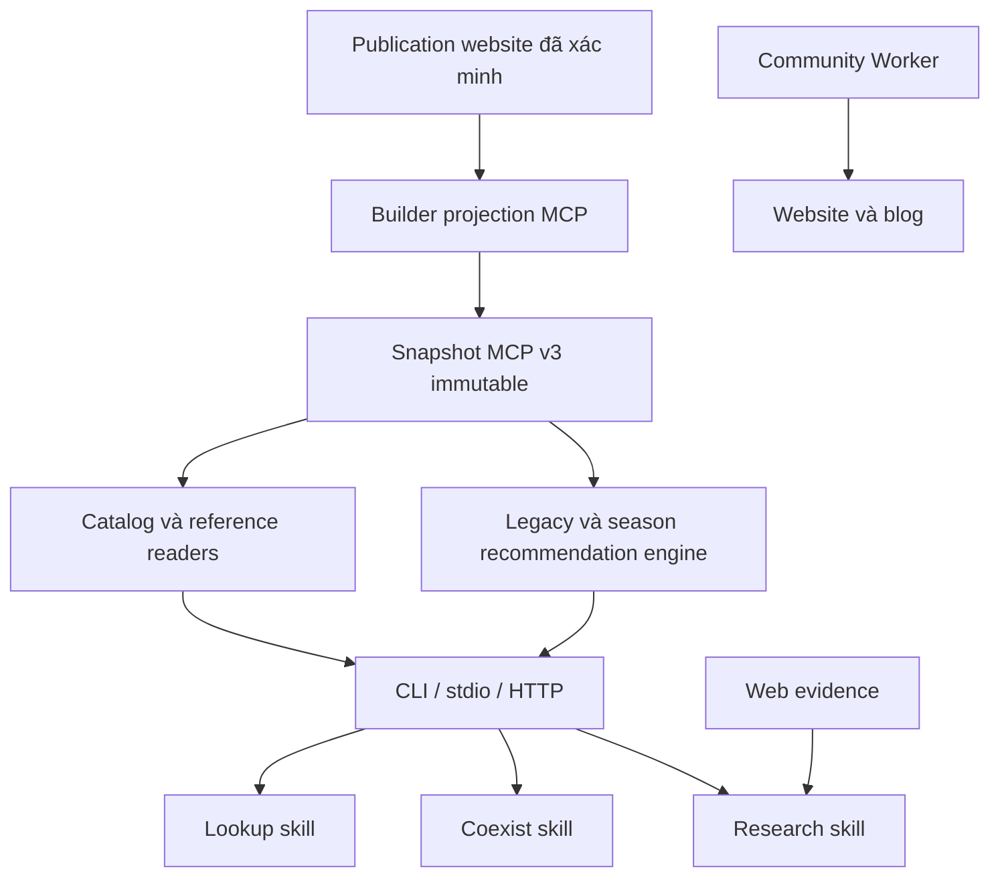

# Kiến trúc MCP và skill đề xuất

Trạng thái: thiết kế để triển khai; tên tool mới và field mới bên dưới **chưa tồn tại** trong runtime.

**Bổ sung 2026-09-27:** [thiết kế skill–MCP và learning](skill-mcp-learning-design.md) mở rộng từ 12 lên 14 tool, thêm searchable knowledge và skill bảo trì. Các mục 12 tool/3 skill dưới đây là lớp nghiệp vụ gốc; phạm vi đầy đủ nằm ở plan index và tài liệu bổ sung.

## 1. Quyết định chính

Mở rộng MCP hiện tại thành giao diện đọc dữ liệu game công khai của repo. Giữ engine recommendation đã có. Bổ sung hai cặp search/detail cho lookup và đội tham khảo; giữ tám tool cũ để consumer không bị chuyển corpus bất ngờ.

Skill chỉ điều phối ý định, scope, xác nhận và cách diễn giải bằng chứng. Validation, canonical identity, filtering, pagination và tính toán nằm trong code có test.

### Ba lựa chọn đã cân nhắc

| Lựa chọn | Đánh giá |
|---|---|
| Chỉ sửa prompt/skill | Không giải quyết phần corpus MCP không truy cập được; tăng nguy cơ agent tự đọc nhầm raw/private |
| Viết server mới, thay toàn bộ tools | Tăng migration và release cost, bỏ phí normalization/binding/parity tests đã có |
| Mở rộng server, thêm read model từ publication | **Chọn**: dùng lại phần đã kiểm chứng và bổ sung đúng khoảng trống |

## 2. Bốn trục ngữ cảnh phải tách riêng

| Trục | Ý nghĩa | Quy tắc |
|---|---|---|
| `sourceSeasonId` | Mùa được nhà cung cấp nguồn gán cho bản ghi | Dùng lọc đội chuẩn; lấy từ seasons publication |
| `seasonContext` | `scenarioId` + `rulesetId` đã review | Chỉ dùng các tool hiện có hỗ trợ scope tính toán; thiếu/sai thì lỗi |
| `locale` | `vi` hoặc `zh`, mặc định `vi` | Chỉ điều khiển hiển thị/link; không suy server |
| server/region | Phạm vi áp dụng game mà user hỏi | Ghi rõ known/unknown trong skill; không chuyển CN sang Global bằng ngôn ngữ |

Build team resolve mùa theo [policy latest và lựa chọn user](season-resolution-design.md), mặc định ban đầu Binh Diễn Xuân Thu. Không lấy `defaultSourceSeasonId` của nguồn làm mùa người dùng. Đọc tham khảo không cần bịa ruleset; recommendation không được vượt gate ruleset chỉ vì reference có sẵn.

## 3. Snapshot và nguồn dữ liệu

### 3.1 Giữ hợp đồng đang có

- V1/V2 vẫn đọc được. Sáu legacy artifacts và năm season sidecars giữ định danh, lọc public và validation hiện tại.
- Giữ `releaseId` full SHA-256; digest workflow/binding vẫn dùng encoding hiện hành.
- `publicSnapshotView` tiếp tục loại dữ liệu bị ẩn cùng liên kết/evidence chỉ phục vụ dữ liệu đó.
- Không mở rộng `tqccl_search` enum hoặc đổi corpus `tqccl_get_team`: consumer strict cũ cần được bảo vệ.

### 3.2 Thêm manifest v3 cho publication

Builder chạy ở Node đọc **cùng các byte đã được website verifier chấp nhận**:

1. Lookup manifest + heroes/tactics/catalog qua validator hiện có.
2. Recommended `current.json` + manifest + exact file inventory; không chọn thư mục mới nhất theo mtime.
3. Website display snapshot: đối chiếu source hashes và recommended pin trước khi áp lớp dịch.
4. Khai hoang từ public bytes đã pin và route catalog/handle ledger tương ứng.

Tạo read model có allowlist field, không copy thư mục `data/` hoặc private `data/sgsdeck/`. Projection giữ ID nguồn, slot/holder, source score, link đã được phép public, translation status và cảnh báo. Website-public không tự động đồng nghĩa được phát tán mọi field private đầu vào: projection chỉ lấy field đang public và cần cho tool.

V3 gồm legacy/season artifacts cộng:

- `catalog-entities`: sáu nhóm lookup, nested specials/options/levels có schema và pagination riêng ở detail.
- `reference-registry`: source season, category, available collection và label.
- `reference-team-index`: summary của `recommended`, `other`, `khaihoang`.
- `reference-team-details`: cấu hình/biến thể/guide đầy đủ theo ID, phân shard nếu vượt giới hạn artifact.
- `public-routes`: mapping ID → đường dẫn đã build được, gồm locale.

Manifest ghi upstream generation/hash và digest từng artifact/shard. Inventory v3 được suy duy nhất từ manifest đã validate; tên shard có grammar cố định, không nhận đường dẫn tùy ý hoặc traversal. Mỗi artifact tối đa 8 MiB như gate hiện hành. Bước 1 phải đo byte thực, chọn số shard deterministic và lưu vào contract trước khi code reader; không tăng trần vì builder chưa chia nhỏ.

Validation hash và shape ở ingress; Worker chỉ đọc immutable Assets. Không import `node:fs`, Astro, DOM hoặc browser globals vào Worker. Shared pure validators/projectors có thể tách từ owner hiện có khi cần, tránh kéo toàn UI vào source graph.

### 3.3 Identity và chuyển version

- V3 `releaseId` bao phủ toàn bộ bytes projection + upstream pins. Thay nội dung/locale/route làm đổi release; `workflowVersion` vẫn kết hợp release + semantic build.
- Cursor bind tool, query/filter chuẩn hóa, locale, ordering và workflowVersion; replay sang tool/filter/version khác bị từ chối.
- Bổ sung capabilities cho catalog/reference/locale và available collections. Không công bố đầy đủ 1.366 records trong version response; registry dài lấy qua browse response có giới hạn.
- `get_data_version` mở rộng output có kế hoạch refresh discovery. Consumer đóng băng schema v1/v2 phải nâng trước promotion; endpoint release cũ là rollback path.
- New tools có mặt ổn định trong catalog code; snapshot v1/v2 trả `CAPABILITY_UNAVAILABLE` cho tool mới. Không trả mảng rỗng gây hiểu nhầm là không có dữ liệu.

## 4. Tool surface mục tiêu: 12 tools

### Giữ tám tool hiện có

| Tool | Vai trò giữ nguyên |
|---|---|
| `tqccl_get_data_version` | Version/capabilities; mở rộng output có migration |
| `tqccl_normalize_entities` | Raw observations → canonical state + review/binding |
| `tqccl_search` | Tìm canonical hero/tactic/team/book trong engine corpus |
| `tqccl_get_team` | Chi tiết engine team/config |
| `tqccl_match_team` | Đối chiếu roster đúng tactic holder |
| `tqccl_recommend_team` | Xếp đội từ state đã xác nhận |
| `tqccl_recommend_coexist` | Portfolio không xung đột từ state đã xác nhận |
| `tqccl_suggest_replacements` | Thay tactic đúng holder/slot; không kế thừa source score |

### Bổ sung bốn tool đọc

Mọi tool mới nhận `expectedWorkflowVersion` bắt buộc, `locale?: vi|zh`. Request strict; query tối đa 256 ký tự, limit mặc định 20/tối đa 50, cursor tối đa 2.048 ký tự. Các ID tối đa 256 ký tự và phải khớp record trong snapshot; không đoán slug.

| Tool mới | Input đặc thù | Output chính |
|---|---|---|
| `tqccl_search_catalog` | `query`, `groups?` từ sáu nhóm, `limit?`, `cursor?` | `items[{entityId,group,displayName,matchedTerm?,pagePath}]`, pagination |
| `tqccl_get_catalog_entity` | `entityId`, `section?`, `limit?`, `cursor?` | Profile có schema theo kind; nested specials/options/levels phân trang; relations có giới hạn |
| `tqccl_browse_reference_teams` | `collection: recommended|other|khaihoang`, `query?`, `sourceSeasonId?`, `sourceCategoryId?`, `limit?`, `cursor?` | Summary, source scope, tier/score nguyên bản, selectors và pagePath; filter options bounded |
| `tqccl_get_reference_team` | `reference` là tagged selector tương ứng collection | Cấu hình nguồn/guide, holder/slot/books/mốc chuyển đội, evidence metadata, link và limitations |

Tagged selectors:

- Recommended: `{collection:"recommended", sourceConfigId}`.
- Other: `{collection:"other", legacyTeamId, legacyVariantId}`; đọc **admitted variant** trong publication, không toàn raw legacy.
- Khai hoang: `{collection:"khaihoang", khaiHoangTeamId}`; guides/chamSuTeams nằm trong context của đúng record khi có liên kết rõ, không ghép tên suy đoán.

`sourceSeasonId`/category chỉ được nhận khi collection có mapping tương ứng. Khai hoang không có source-season registry tương đương thì schema/handler từ chối filter đó, giải thích phạm vi bảo trì hiện tại. Hero/tactic search hỗ trợ tên Việt/Hán/Hán-Việt/alias từ dữ liệu hiện có. Không thêm fuzzy match âm thầm đổi identity.

### Envelope, bounds và lỗi

- Thành công: giữ `releaseId`, `dataVersion`, `workflowVersion`, `provenance`, `warnings`, `truncated`; thêm `items` hoặc `entity/reference` theo tool, `nextCursor` khi còn dữ liệu.
- Reference có `purpose:"reference"`; applicability lấy bằng chứng thật hoặc `unknown`, không default VN/Global. Claim status do skill đánh giá, không tự gắn “Đã đối chiếu” vì JSON hợp lệ.
- JSON schema hữu hạn theo kind, tránh `record<string,unknown>`/`unknown` cho hợp đồng mới. Validation success riêng và public error branch đều được client test.
- Tối đa 64 KiB/result theo gate hiện tại; cắt theo records/sections, giữ JSON hợp lệ, ghi omitted counts. Detail quá lớn dùng `section`/cursor; không lược slot trọng yếu rồi trình bày là cấu hình đầy đủ.
- Giữ lỗi hiện có; thêm lỗi cụ thể `CAPABILITY_UNAVAILABLE`, `ENTITY_NOT_FOUND`, `REFERENCE_NOT_FOUND`, `REFERENCE_SCOPE_INVALID` với `nextAction`, `retryable=false`. Không phản chiếu exception/input/credential.
- Path là route đã validate; origin do deployment config có allowlist quyết định. Không nhận URL/host tùy ý từ caller để fetch.

Tools dùng structuredContent + text JSON tương đương; outputSchema phải validate cả lỗi sau `tools/list`. Đây là yêu cầu tương thích theo [MCP tools spec đang được repo pin](https://modelcontextprotocol.io/specification/2025-11-25/server/tools). Giữ SDK 1.30.0/protocol 2025-11-25; nâng SDK là dự án riêng có client compatibility evidence.

## 5. Thiết kế skill: ba intent, ba owner

### `tqccl-lookup` — mới

**Kích hoạt:** tra tướng/chiến pháp/trang bị/quân sư/cải tạo/công trình; xem đội chuẩn, đội khác hoặc Khai hoang trong cẩm nang. Không kích hoạt cho “xây đội từ kho” hoặc “chứng minh cơ chế/meta mới nhất”.

Luồng:

1. Discovery thực tế → version → chọn locale và loại truy vấn.
2. Catalog: search_catalog → get_catalog_entity. Team tham khảo: browse_reference_teams → get_reference_team.
3. Nhiều kết quả khác identity thì cho chọn; không tự lấy kết quả đầu cho tên mơ hồ.
4. Trả dữ liệu nguồn, scope, version và link. So sánh nguồn được, không đưa ra khả năng sở hữu hay khẳng định meta hiện tại.
5. Không có MCP thì dùng cùng JSON CLI khi có repo; không có cả hai thì báo giới hạn và link site, không giả chạy tool.

Package: `SKILL.md`, `agents/openai.yaml`, `references/tool-routing.md`, `evals/evals.json`. References chứa cách lựa tool/lỗi, không copy toàn schema hoặc hardcode count.

### `tqccl-coexist-team-builder` — sửa tại chỗ

Giữ tên skill và khóa tactic/tier đã chốt; thu hẹp description về xây đội từ kho và portfolio. Nghiên cứu web chuyển sang research skill.

Luồng chuẩn:

1. Đọc roster/locked teams do user cung cấp trong phiên; unknown khác confirmed-empty. Ảnh cần capability đọc ảnh và dữ liệu trích xuất để user review; MCP không nhận ảnh.
2. Version/capabilities → normalize → hiển thị ambiguity/canonical state → user xác nhận state cụ thể.
3. Recommend team/coexist theo nhu cầu. Binding chỉ chứng minh state/version, không chứng minh đã có consent.
4. Get team/replacements khi cần; sửa roster/locks/context thì normalize và xác nhận lại.
5. Đọc source reference để đối chiếu bằng tool mới, nhưng không đưa 1.366 cấu hình chưa có eligibility vào engine.
6. Khi không có seasonal ruleset hợp lệ, giải thích chưa gợi ý theo scope đó được; không ngầm chạy legacy. User chủ động chọn legacy thì mới đi tiếp.

Python helper cũ không còn là nguồn recommendation cuối. Chuyển thành wrapper cùng CLI hoặc retire sau khi tìm caller và có parity test. Không duy trì hai thuật toán. Bỏ đường `/Users/...`; dùng đường tương đối từ project/skill location.

Reference account cũ chỉ là bối cảnh lịch sử có xuất xứ, không tự áp cho user/phiên mới. Không đóng gói nội dung account vào skill dùng chung; không xóa file người dùng khi chưa có phạm vi dọn dữ liệu.

### `tqccl-research` — giữ purpose, bổ sung đường dữ liệu

Giữ ba intent, ba claim statuses, SGSDeck anchor, region/preview discipline, correction history và **5 external calls/topic**. Dùng lookup/reference tools để xác định điều website đang hiển thị; đọc nguồn thực để kết luận mechanic/meta.

- Local filesystem/CLI reads là local operations; MCP qua remote là external operation và được tính vào ledger hiện có. Không tự miễn budget vì endpoint chứa dữ liệu của repo.
- Ghi rõ provenance của runtime observation so với independent source evidence.
- Khi user chỉ muốn xem catalog, route lookup; muốn xếp đội từ kho, route coexist; muốn kiểm chứng cơ chế, stay research.
- Không nâng Phase 2/3 cũ thành đạt. Candidate mới cần instruction hash mới, baseline có provenance và rerun phần ảnh hưởng; không tái dùng capture của hash cũ như validation mới.

### Quyền sở hữu consumer

Ba skill trên thuộc project hiện tại. GoClaw hoặc ứng dụng ngoài có skill riêng do consumer owner duy trì theo handoff; họ tái sử dụng tool contract, không tái sử dụng đường file local hay account history. Không thêm host config/token vào repo.

## 6. Community, blog, tracker và vision

- Community auth/session/moderation dùng Worker riêng. Research MCP bearer không được coi là Google user/admin session.
- Bài published và chiến báo approved có thể là nguồn research untrusted, không tự trở thành team tier hoặc xác nhận win rate.
- Blog được fetch lúc build; empty local blog khi thiếu API config không chứng minh production không có bài.
- Đợt này không sinh community CRUD tools, không đọc D1/R2/admin API, không làm publication phụ thuộc service động.
- Nếu mở public community search sau này: contract freshness + moderation + public-field allowlist riêng; write/admin cần identity/scopes/audit riêng. Đó là quyết định sản phẩm mới.
- Tracker vẫn localStorage, vision vẫn worker riêng; không gom account/media vào snapshot game.

## 7. Đường triển khai và rủi ro

Ưu tiên: publication snapshot → bốn tools → skills → consumer compatibility/release. Giữ implementation ở checkout có ownership rõ; baseline WIP hiện tại không đủ để tự tạo clean release.

| Rủi ro | Cách kiểm soát |
|---|---|
| Trộn generation trong lúc build | đọc verified bytes một lần; kiểm pin trước/sau; fail closed |
| Link đúng ID nhưng sai locale/handle | lấy route catalog cùng generation; test vi/zh và mutation tên |
| Source score bị dùng để xếp Global | reference purpose + applicability + negative behavioral cases |
| Search mới đụng engine identity cũ | namespace/selector riêng và explicit canonical mapping |
| Prompt và schema lệch nhau | discovery thật; references link owner schema; không copy schema |
| Strict client không nhận output mới | replay client cũ/mới, refresh discovery trước promotion |
| Skill cũ chưa có behavioral pass | capture theo hash/case; ghi NOT_RUN/BLOCKED chính xác |

Rollback code+data bằng exact Worker version như runbook hiện hành; rollback skill theo version riêng. Consumer phải refresh version/discovery và bỏ state/binding/cursor cũ sau rollback.
