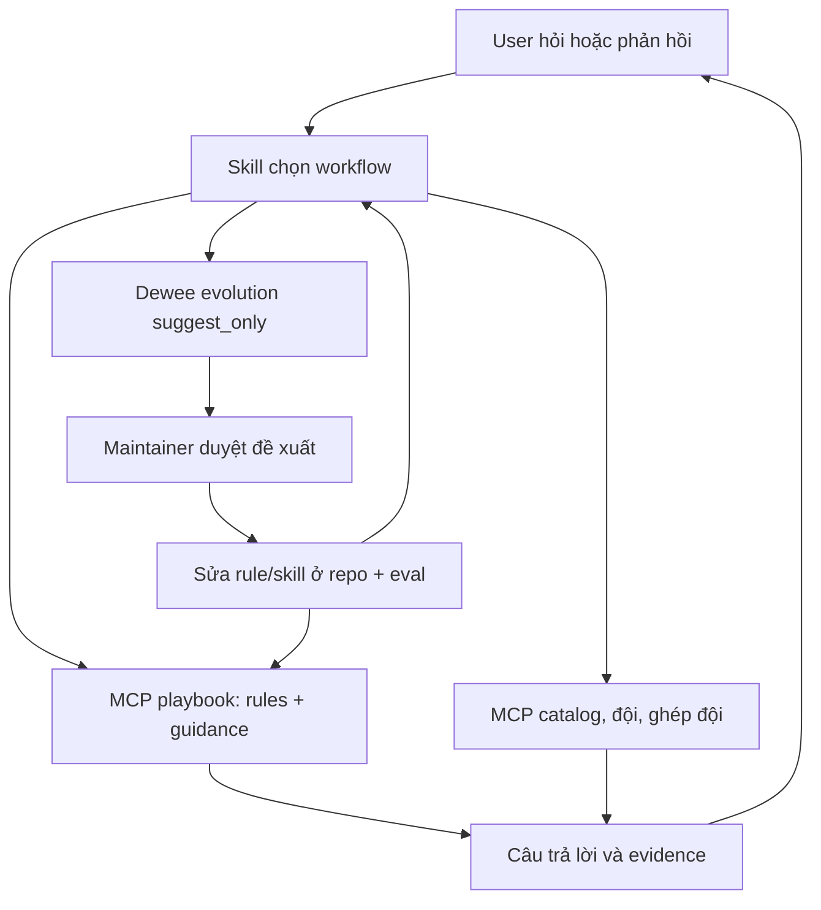

# Skill, MCP, dataset và vòng học từ feedback

Ngày: 2026-09-27. **Thiết kế và prototype**, chưa cài skill hoặc đổi MCP production.

Mở rộng [thiết kế trước](design.md) với knowledge dataset và 3 skill nghiệp vụ. Bề mặt tool chốt 2026-10-07 là **7 tool P\*** ([design §4](design.md)); không giữ hợp đồng 8 tool cũ. Vòng học dùng skill evolution `suggest_only` của Dewee ([phase 3](phase-03-learning.md)); `tqccl-improve` và store feedback riêng đã bỏ (user 2026-10-07).

**Quyết định mùa chơi:** [season design](season-resolution-design.md) — chọn mùa nguồn trước build như trang Gợi ý kho: user chỉ định/đã xác nhận, nếu thiếu thì `defaultSourceSeasonId` của bản publish (user 2026-10-07).

## 1. Outcome

Skill chọn quy trình; MCP cung cấp dữ liệu, phép tính và hướng dẫn theo ngữ cảnh. Các skill bàn giao kết quả có cấu trúc. Mỗi feedback được ghi nhận một lần, sửa câu trả lời hiện tại và tạo đầu vào cho lần dùng sau.

Học có ba kết quả: preference riêng, rule/workflow dùng chung, hoặc yêu cầu sửa code/data. Một lần không hài lòng không tự trở thành luật game hay policy mới.

## 2. Học từ UI UX Pro Max

Đã đọc source tại commit `823b0a14d3539b5d78c0efb614426a4fab5983ec`; không chạy script upstream hay cài plugin.

| Cơ chế đã đọc | Áp dụng |
|---|---|
| CSV chia domain, search/output columns riêng | Dataset theo nghiệp vụ; trả đúng field cần dùng |
| BM25, exact identity, filter, diagnostics, abstention | Rank guidance; query yếu được trả no-match |
| Decision rules dùng grammar đóng | Điều kiện/action chỉ thuộc allowlist; không execute dataset |
| Search CLI hỗ trợ JSON và focused query | Một intent/query; output có giới hạn |
| Relevance eval có calibration/held_out và fingerprints | Đo retrieval độc lập, pin data/code/oracle |
| Master và page overrides, persistence không ghi đè mặc định | Preference scoped và bảo toàn quyết định đã chốt |

Source: [core.py](https://github.com/nextlevelbuilder/ui-ux-pro-max-skill/blob/823b0a14d3539b5d78c0efb614426a4fab5983ec/src/ui-ux-pro-max/scripts/core.py), [reasoning contract](https://github.com/nextlevelbuilder/ui-ux-pro-max-skill/blob/823b0a14d3539b5d78c0efb614426a4fab5983ec/src/ui-ux-pro-max/scripts/reasoning_contract.py), [search CLI](https://github.com/nextlevelbuilder/ui-ux-pro-max-skill/blob/823b0a14d3539b5d78c0efb614426a4fab5983ec/src/ui-ux-pro-max/scripts/search.py), [relevance evaluator](https://github.com/nextlevelbuilder/ui-ux-pro-max-skill/blob/823b0a14d3539b5d78c0efb614426a4fab5983ec/scripts/evaluate-relevance.py).

Các file đã đọc chứng minh retrieval/evaluation, chưa chứng minh vòng tự cập nhật từ feedback. Không copy ngưỡng BM25 hoặc dataset UI sang game. Tokenizer Việt/Hán cần bộ đo riêng.

## 3. Hai vòng



Vòng phục vụ đọc knowledge ổn định và sửa output ngay khi user góp ý. Vòng cải thiện đi qua đề xuất của Dewee và maintainer duyệt; không bắt mọi đề xuất tạo thêm rule.

## 4. Các skill bổ trợ nhau

| Skill | Sở hữu | Bàn giao |
|---|---|---|
| `tqccl-lookup` | Resolve tên/ID, đọc catalog/reference, source scope/link | Xếp theo kho → coexist; kiểm chứng mechanic → research |
| `tqccl-coexist-team-builder` | Roster, normalization, confirmation, engine, trade-off | Detail/identity → lookup; cơ chế chưa rõ → research |
| `tqccl-research` | Claim, source inspection, correction history, budget | Trả evidence đã kiểm tra về workflow gọi nó |

Bàn giao là chuyển workflow trong cùng agent hoặc dispatcher đã được cấp quyền; không bắt buộc subagent. Một workflow sở hữu câu trả lời cuối. Mỗi handoff có reason/returnTo. Không lặp research → coexist → research khi chưa có evidence mới. Đề xuất thử nghiệm tối đa ba handoff/lượt, đo rồi điều chỉnh; chưa gọi đây là ngưỡng đã kiểm chứng.

### Work packet

Schema dự kiến `agent-knowledge/schemas/work-packet.schema.json`:

- `taskId`, `topicId`, `ownerWorkflow`, `returnTo`, `requestedOutcome`.
- `scope`: sourceSeasonId, scenario/ruleset, region, locale; unknown rõ và provenance cho scope kế thừa.
- `entityRefs`, `referenceRefs`: ID và release identity; không copy toàn catalog.
- `canonicalStateRef`, `confirmationBinding`: consumer-private, không lưu dataset chung.
- `claims[{claimId,status,scope,evidenceRefs}]`, `unresolved`.
- `budget{topicId,limit,used,remaining}` dùng chung, không reset khi đổi skill.
- `versions{gameReleaseId,workflowVersion,knowledgeVersion,skillVersion}`, `appliedRuleIds`.

Chỉ truyền phần cần thiết; không transcript/token/ảnh thô. State/scope đổi vẫn review lại.

## 5. MCP được thiết kế để skill dùng tốt hơn

Bề mặt 7 tool P\* ([design §4](design.md)); playbook dưới đây là một trong bảy và thay `get_data_version`. `tqccl_search_rules` là core + CLI; chỉ đăng ký tool MCP khi chạm ngưỡng ở [phase 2](phase-02-skills.md).

### `tqccl_get_playbook`

Input: `intent:lookup|coexist|research`, `stage?`, typed `context?`, `locale?:vi|zh`, `expectedKnowledgeVersion?`.

Output: game/workflow/knowledge versions, workflow card, required rules, toàn bộ guidance của workflow/stage kèm `guidanceCount`/`guidanceBytes`/`guidanceTruncated`, missing prerequisites, next-step tool names có thật trong discovery, output checklist và error recovery. Call đầu lấy luôn versions để tránh version call dư; các bước sau pin identity.

Recipe từ dataset đã review, không phải plan tùy ý do server model sinh. Thiếu capability trả unavailable rõ. Không trả toàn bộ SKILL.md/schema. Caller context không chứng minh consent hoặc tính đúng của game facts.

### `tqccl_search_rules`

Input: query tối đa 256 ký tự, workflow/context, expectedKnowledgeVersion, limit mặc định 3/tối đa 10, exact ruleIds tùy chọn tối đa 20.

Output: required rules, top-k guidance, unresolvedConditions, matchedTerms, ruleId/revision/sourceRefs, version, abstained/reason và optional diagnostics. Mục tiêu output guidance tối đa 16 KiB; required rules vượt bound phải trả lỗi cần chia stage, không cắt âm thầm.

- Exact ID vẫn kiểm status/scope; retired record có successor.
- Không match guidance không cho phép bỏ invariant.
- Lỗi: KNOWLEDGE_VERSION_CHANGED, KNOWLEDGE_UNAVAILABLE, RULE_SCOPE_INVALID, PLAYBOOK_NOT_FOUND; schema validate cả nhánh error.
- Annotations: readOnly=true, destructive=false, idempotent=true, openWorld=false với snapshot đóng gói.

### Feedback ở phía consumer

MCP game read-only; không thêm write-feedback vào token game. Feedback và đề xuất cải tiến nằm ở Dewee (skill evolution `suggest_only`, [phase 3](phase-03-learning.md)). Không nhầm Google/community session với MCP bearer.

## 6. Dataset thay cho rule dài trong Markdown

```text
agent-knowledge/                 # canonical source dự kiến
  manifest.json                  # digest, schema, compatibility
  workflows.json                 # workflow cards và recovery
  rules/core.jsonl
  rules/lookup.jsonl
  rules/coexist.jsonl
  rules/research.jsonl
  aliases.json                    # search terms; không sửa hero identity
  schemas/                        # rules, handoff, feedback, candidate, metrics
mcp-worker/src/knowledge/         # pure TS dùng chung CLI/Worker
  search-rules.ts
  resolve-playbook.ts
  rule-contracts.ts
.agents/skills/tqccl-*/SKILL.md    # intent, workflow nhỏ, tool use, boundary
```

Tách khỏi `data/` game để không vô tình vào public website manifest. Chỉ stable public guidance được đóng vào private Worker Assets. Profile/feedback/eval traces không đi vào bundle.

JSONL cho rule có scopes/evidence/arrays; CSV cho dữ liệu phẳng. Index sinh từ dataset, không sửa index như source. Một nguồn canonical, build adapters cho host khi cần.

Markdown giữ entrypoint/routing/thứ tự/cách dùng tools và fallback. Code/tests giữ enforcement auth/schema/binding/locks/scope. Dataset giải thích và phân phối guidance, không thay enforcement. Game facts thuộc evidence/data pipeline, không thuộc preference learning.

### Rule schema và precedence

`id`, `revision`, `kind:invariant|guidance|preference`, `status:candidate|active|deprecated`, `workflows`, `stage`, `scope`, `when`, `action`, `explanation`, `sourceRefs`, `validFrom`, `reviewAfter`, `supersedes`, `regressionCaseIds`.

Grammar đóng: all/any + field allowlist + eq/in/exists; values typed. Actions enum như require-context, disallow-claim, show-warning, prefer-output-format, route-workflow. Không eval, shell, arbitrary regex/import/fetch. Dataset không có quyền mở tool hay thay instruction hierarchy.

Trong preference hợp lệ: current explicit choice → confirmed user/account scope → project default. Correctness/security invariants không bị preference ghi đè. Hai active rules cùng scope trái nhau chặn release hoặc báo conflict; không tự chọn dòng mới nhất. Quyết định user đã chốt không bị audit/học ngầm đảo.

## 7. Search pipeline

1. Validate manifest/version/scope.
2. Chọn đủ invariants bằng selector deterministic, không qua top-k.
3. Thiếu facts trả unresolvedConditions; unknown không phải false.
4. Filter guidance theo workflow/stage/region/ruleset/status trước ranking.
5. Exact ID/alias rồi BM25 weighted fields. Không merge SP/CO/base identity.
6. Việt có dấu/không dấu; Chinese unigram/bigram cần eval; giữ raw IDs.
7. Calibrate score, coverage và margin trên train; abstain khi không đủ match. Retrieval score không phải claim confidence.
8. Cache theo content digest + schema/tokenizer/ranker version + scope, không chỉ mtime/size.

Lexical search trước vì corpus nhỏ và đo được. Embedding chỉ thêm nếu benchmark cho thấy thiếu recall đáng kể; chưa thêm service/dependency.

## 8. Vòng học

Xem [phase 3](phase-03-learning.md): Dewee `suggest_only` ghi metric và đề xuất; maintainer duyệt, sửa ở repo, release. Repo là bản gốc; không apply trên Dewee.

Phân loại đề xuất trước khi sửa:

| Loại | Xử lý |
|---|---|
| Preference cá nhân ("trả bảng ngắn hơn") | Không vào rule chung |
| Input người chơi ("tôi không có tướng đó") | Account input; không là rule |
| Game fact correction | Research evidence + regression trước khi đổi |
| Lỗi rule/workflow | Rule trong `agent-knowledge/` hoặc sửa `SKILL.md`, kèm case |
| Retrieval gap | Alias/ranker/data + retrieval case |
| Tool bug, outage | Chuyển owner code/data; không thành rule game |

Game `workflowVersion` bind engine code/data; `knowledgeVersion` bind guidance riêng. Inventory Worker có hai manifest con (game v3 và knowledge), outer inventory bao cả hai; deploy nguyên tử code+data+knowledge theo Worker version.

## 9. Kiểm chứng học có ích

- Retrieval: required coverage, precision/recall@k, false-match/abstention theo workflow/ngôn ngữ.
- Task: tool/routing traces thật, scope/locks/score, đáp ứng correction.
- Before/after cùng snapshot/tools/runtime/case; holdout riêng; invariants zero violations; metric mềm calibrate trước khi dùng gate.

## 10. CLI thật dự kiến

**Chưa triển khai:**

```text
npm run cli -- playbook --input <json>
npm run cli -- search-rules --input <json>
```

Không secrets/roster trong argv. CLI/MCP dùng chung TS core. Python probe bên dưới không trở thành engine production thứ hai.

## 11. Prototype có thể chạy

- [rules.json](prototype/rules.json): 14 rules có provenance, phân biệt existing contract và design proposal.
- [search-rules.py](prototype/search-rules.py): required selection + BM25 guidance; xử lý Việt/Hán và unknown conditions.
- [test-search-rules.py](prototype/test-search-rules.py): 10 deterministic checks đã đạt.

```sh
python3 plans/260927-1727-mcp-skill-redesign/prototype/search-rules.py \
  'nhieu hot' --workflow coexist \
  --context '{"seasonal":false,"configChanged":false}' --limit 1
```

Quan sát: coexist-priority đứng đầu, 5 required rules vẫn đủ dù limit=1. Query vô nghĩa abstain; unknown seasonal được báo; query `装备` tìm đúng guidance catalog.

Giới hạn: chưa production schema validator, chưa calibration, chưa feedback hooks/store/promotion hay consumer A/B. Không chứng minh tiết kiệm token. Không import prototype vào runtime.

## 12. Acceptance bổ sung

- 7 tools discovery/parity, schemas/errors/version/capability recovery.
- Handoff giữ scope/budget/state; không lặp vô hạn.
- Required rules không rơi khỏi top-k; unknown/conflict rõ.
- Đề xuất evolution chỉ đi vào repo sau khi duyệt và qua eval; hash skill trên Dewee khớp repo.
- Injection/stale evidence/contradictory feedback không tự thành active rule.
- Matched consumer outcome evidence trước tuyên bố skill tự cải thiện hiệu quả.

## Câu hỏi khi triển khai

Bật evolution `suggest_only` sau khi upload skill; xác nhận `skill_usage_metrics` có dữ liệu thật trước khi coi vòng học đang chạy.
