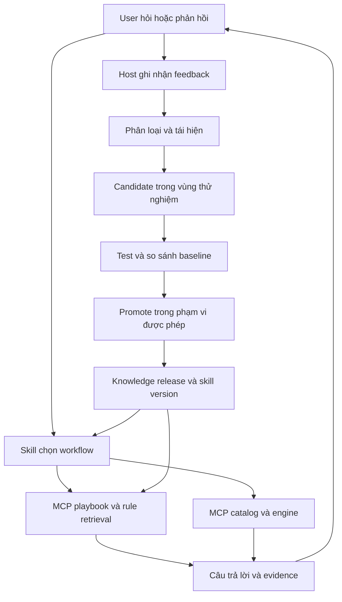

# Skill, MCP, dataset và vòng học từ feedback

Ngày: 2026-09-27. **Thiết kế và prototype**, chưa cài skill hoặc đổi MCP production.

Mở rộng [thiết kế trước](design.md) thành **14 tool đọc, 3 skill nghiệp vụ và 1 skill bảo trì**. Giữ hợp đồng game/consumer cũ; tài liệu này thay mốc 12 tool và bổ sung learning loop.

**Quyết định mùa chơi:** [season resolution](season-resolution-design.md) bổ sung bước chọn mùa trước build: user đã chọn được ưu tiên, nếu thiếu thì latest động; Binh Diễn Xuân Thu là default ban đầu theo user.

## 1. Outcome

Skill chọn quy trình; MCP cung cấp dữ liệu, phép tính và hướng dẫn theo ngữ cảnh. Các skill bàn giao kết quả có cấu trúc. Mỗi feedback được ghi nhận một lần, sửa câu trả lời hiện tại và tạo đầu vào cho lần dùng sau.

Học có ba kết quả: preference riêng, rule/workflow dùng chung, hoặc yêu cầu sửa code/data. Một lần không hài lòng không tự trở thành luật game hay policy mới.

## 2. Học từ UI UX Pro Max

Đã đọc source tại commit `823b0a14d3539b5d78c0efb614426a4fab5983ec`; không chạy script upstream hay cài plugin.

| Cơ chế đã đọc | Áp dụng |
|---|---|
| CSV chia domain, search/output columns riêng | Dataset theo nghiệp vụ; trả đúng field cần dùng |
| BM25, exact identity, filter, diagnostics, abstention | Rank guidance; query yếu được trả no-match |
| Decision rules dùng grammar đóng | Điều kiện/action chỉ thuộc allowlist; không execute dataset |
| Search CLI hỗ trợ JSON và focused query | Một intent/query; output có giới hạn |
| Relevance eval có calibration/held_out và fingerprints | Đo retrieval độc lập, pin data/code/oracle |
| Master và page overrides, persistence không ghi đè mặc định | Preference scoped và bảo toàn quyết định đã chốt |

Source: [core.py](https://github.com/nextlevelbuilder/ui-ux-pro-max-skill/blob/823b0a14d3539b5d78c0efb614426a4fab5983ec/src/ui-ux-pro-max/scripts/core.py), [reasoning contract](https://github.com/nextlevelbuilder/ui-ux-pro-max-skill/blob/823b0a14d3539b5d78c0efb614426a4fab5983ec/src/ui-ux-pro-max/scripts/reasoning_contract.py), [search CLI](https://github.com/nextlevelbuilder/ui-ux-pro-max-skill/blob/823b0a14d3539b5d78c0efb614426a4fab5983ec/src/ui-ux-pro-max/scripts/search.py), [relevance evaluator](https://github.com/nextlevelbuilder/ui-ux-pro-max-skill/blob/823b0a14d3539b5d78c0efb614426a4fab5983ec/scripts/evaluate-relevance.py).

Các file đã đọc chứng minh retrieval/evaluation, chưa chứng minh vòng tự cập nhật từ feedback. Không copy ngưỡng BM25 hoặc dataset UI sang game. Tokenizer Việt/Hán cần bộ đo riêng.

## 3. Hai vòng dùng chung



Vòng phục vụ đọc knowledge ổn định và sửa output ngay khi user góp ý. Vòng cải thiện gom feedback, tái hiện, thử một thay đổi, đo, giữ/loại có giới hạn. Không chạy thí nghiệm dài trước khi trả lời user. Không bắt mọi feedback tạo thêm rule.

## 4. Các skill bổ trợ nhau

| Skill | Sở hữu | Bàn giao |
|---|---|---|
| `tqccl-lookup` | Resolve tên/ID, đọc catalog/reference, source scope/link | Xếp theo kho → coexist; kiểm chứng mechanic → research |
| `tqccl-coexist-team-builder` | Roster, normalization, confirmation, engine, trade-off | Detail/identity → lookup; cơ chế chưa rõ → research |
| `tqccl-research` | Claim, source inspection, correction history, budget | Trả evidence đã kiểm tra về workflow gọi nó |
| `tqccl-improve` (maintainer) | Feedback, reproduction, candidate, eval, promotion | Lỗi code/data chuyển owner; không tự biến thành rule |

Bàn giao là chuyển workflow trong cùng agent hoặc dispatcher đã được cấp quyền; không bắt buộc subagent. Một workflow sở hữu câu trả lời cuối. Mỗi handoff có reason/returnTo. Không lặp research → coexist → research khi chưa có evidence mới. Đề xuất thử nghiệm tối đa ba handoff/lượt, đo rồi điều chỉnh; chưa gọi đây là ngưỡng đã kiểm chứng.

### Work packet

Schema dự kiến `agent-knowledge/schemas/work-packet.schema.json`:

- `taskId`, `topicId`, `ownerWorkflow`, `returnTo`, `requestedOutcome`.
- `scope`: sourceSeasonId, scenario/ruleset, region, locale; unknown rõ và provenance cho scope kế thừa.
- `entityRefs`, `referenceRefs`: ID và release identity; không copy toàn catalog.
- `canonicalStateRef`, `confirmationBinding`: consumer-private, không lưu dataset chung.
- `claims[{claimId,status,scope,evidenceRefs}]`, `unresolved`.
- `budget{topicId,limit,used,remaining}` dùng chung, không reset khi đổi skill.
- `versions{gameReleaseId,workflowVersion,knowledgeVersion,skillVersion}`, `appliedRuleIds`.

Chỉ truyền phần cần thiết; không transcript/token/ảnh thô. State/scope đổi vẫn review lại.

## 5. MCP được thiết kế để skill dùng tốt hơn

Giữ 12 tools từ thiết kế trước, thêm hai tool chỉ đọc cùng implementation với CLI.

### `tqccl_get_playbook`

Input: `intent:lookup|coexist|research`, `stage?`, typed `context?`, `locale?:vi|zh`, `expectedKnowledgeVersion?`.

Output: game/workflow/knowledge versions, workflow card, required rules, missing prerequisites, next-step tool names có thật trong discovery, output checklist và error recovery. Call đầu lấy luôn versions để tránh version call dư; các bước sau pin identity.

Recipe từ dataset đã review, không phải plan tùy ý do server model sinh. Thiếu capability trả unavailable rõ. Không trả toàn bộ SKILL.md/schema. Caller context không chứng minh consent hoặc tính đúng của game facts.

### `tqccl_search_rules`

Input: query tối đa 256 ký tự, workflow/context, expectedKnowledgeVersion, limit mặc định 3/tối đa 10, exact ruleIds tùy chọn tối đa 20.

Output: required rules, top-k guidance, unresolvedConditions, matchedTerms, ruleId/revision/sourceRefs, version, abstained/reason và optional diagnostics. Mục tiêu output guidance tối đa 16 KiB; required rules vượt bound phải trả lỗi cần chia stage, không cắt âm thầm.

- Exact ID vẫn kiểm status/scope; retired record có successor.
- Không match guidance không cho phép bỏ invariant.
- Lỗi: KNOWLEDGE_VERSION_CHANGED, KNOWLEDGE_UNAVAILABLE, RULE_SCOPE_INVALID, PLAYBOOK_NOT_FOUND; schema validate cả nhánh error.
- Annotations: readOnly=true, destructive=false, idempotent=true, openWorld=false với snapshot đóng gói.

### Feedback writer thuộc consumer

Bearer MCP hiện tại chưa có user/tenant identity cho kho học. Không thêm write-feedback vào token game đó. Local dùng host script/SQLite; GoClaw có adapter ghi feedback tại storage consumer rồi export sanitized cases. Remote learning service nếu cần phải có auth theo subject, quotas và access control riêng. Không nhầm Google/community session với MCP bearer.

## 6. Dataset thay cho rule dài trong Markdown

```text
agent-knowledge/                 # canonical source dự kiến
  manifest.json                  # digest, schema, compatibility
  workflows.json                 # workflow cards và recovery
  rules/core.jsonl
  rules/lookup.jsonl
  rules/coexist.jsonl
  rules/research.jsonl
  aliases.json                    # search terms; không sửa hero identity
  schemas/                        # rules, handoff, feedback, candidate, metrics
mcp-worker/src/knowledge/         # pure TS dùng chung CLI/Worker
  search-rules.ts
  resolve-playbook.ts
  rule-contracts.ts
scripts/skill-learning.mjs        # maintainer CLI, ngoài game Worker
.agents/skills/tqccl-*/SKILL.md    # intent, workflow nhỏ, tool use, boundary
```

Tách khỏi `data/` game để không vô tình vào public website manifest. Chỉ stable public guidance được đóng vào private Worker Assets. Profile/feedback/eval traces không đi vào bundle.

JSONL cho rule có scopes/evidence/arrays; CSV cho dữ liệu phẳng. Index sinh từ dataset, không sửa index như source. Một nguồn canonical, build adapters cho host khi cần.

Markdown giữ entrypoint/routing/thứ tự/cách dùng tools và fallback. Code/tests giữ enforcement auth/schema/binding/locks/scope. Dataset giải thích và phân phối guidance, không thay enforcement. Game facts thuộc evidence/data pipeline, không thuộc preference learning.

### Rule schema và precedence

`id`, `revision`, `kind:invariant|guidance|preference`, `status:candidate|active|deprecated`, `workflows`, `stage`, `scope`, `when`, `action`, `explanation`, `sourceRefs`, `validFrom`, `reviewAfter`, `supersedes`, `regressionCaseIds`.

Grammar đóng: all/any + field allowlist + eq/in/exists; values typed. Actions enum như require-context, disallow-claim, show-warning, prefer-output-format, route-workflow. Không eval, shell, arbitrary regex/import/fetch. Dataset không có quyền mở tool hay thay instruction hierarchy.

Trong preference hợp lệ: current explicit choice → confirmed user/account scope → project default. Correctness/security invariants không bị preference ghi đè. Hai active rules cùng scope trái nhau chặn release hoặc báo conflict; không tự chọn dòng mới nhất. Quyết định user đã chốt không bị audit/học ngầm đảo.

## 7. Search pipeline

1. Validate manifest/version/scope.
2. Chọn đủ invariants bằng selector deterministic, không qua top-k.
3. Thiếu facts trả unresolvedConditions; unknown không phải false.
4. Filter guidance theo workflow/stage/region/ruleset/status trước ranking.
5. Exact ID/alias rồi BM25 weighted fields. Không merge SP/CO/base identity.
6. Việt có dấu/không dấu; Chinese unigram/bigram cần eval; giữ raw IDs.
7. Calibrate score, coverage và margin trên train; abstain khi không đủ match. Retrieval score không phải claim confidence.
8. Cache theo content digest + schema/tokenizer/ranker version + scope, không chỉ mtime/size.

Lexical search trước vì corpus nhỏ và đo được. Embedding chỉ thêm nếu benchmark cho thấy thiếu recall đáng kể; chưa thêm service/dependency.

## 8. Learning loop mỗi lần có feedback

### Trigger và capture

Host bắt user turn phản hồi kết quả trước; skill gọi capture trong chính lượt đó. Task nền chỉ chạy khi host có job runner đã cấu hình. MCP không thấy mọi user message; SKILL.md không tự chạy khi agent không active.

Không rõ ý feedback thì triage unclassified, chưa promote. Event tối thiểu: eventId, host-derived subjectRef, taskId/responseId/userTurnId, createdAt, category, summaryRedacted, affectedRuleIds, toolTraceRefs, versions, scope, desiredOutcome, evidenceRefs, status.

Subject lấy từ host, không từ tenant ID tùy ý trong prompt. Unique key subject+turn+response làm retry idempotent. Lưu correction cần thiết, không mặc định transcript/roster/ảnh/credential. Cho amend/retract và truy ngược derived records.

### Feedback đi đâu

| Loại | Xử lý ngay | Học lâu dài |
|---|---|---|
| “Trả bảng ngắn hơn” | Đổi format | Preference đúng user/project |
| “Tôi không có tướng đó” | Sửa roster, normalize/review | Account input; không là global rule |
| Game fact correction | Rút/đánh dấu claim cần kiểm | Research evidence + regression, không auto tin như nguồn độc lập |
| Skill gap | Làm lại bước thiếu | Candidate workflow/rule có trace |
| Retrieval gap | Tìm lại đúng guidance | Candidate alias/ranker/data + retrieval cases |
| Tool bug | Báo lỗi/khôi phục | Test/code patch tại MCP owner |
| Outage/quota | Nói giới hạn | Operational event; không rule game |
| Khen hoặc ý chưa rõ | Ghi nhận | Weak signal, chưa thành invariant |

State machine: captured → triaged → reproduced → candidate → evaluated → promoted. Nhánh kết thúc: preference-applied, input-updated, no-change, needs-evidence, rejected, blocked, reverted.

Dedup feedback cùng failure signature trước tạo candidate. Đề xuất tối đa 3 candidates/issue/một lượt cải thiện, không reset budget sau fail. Network research vẫn theo ledger topic hiện hành; eval budget riêng phải do host cấu hình, không tuyên bố miễn phí.

### Mức tự động hóa

- Sửa output ngay theo feedback rõ, không hỏi lại điều user đã nói.
- Preference tự lưu khi host đã bật learning cho subject/scope; user có xem/sửa/quên, không auto share.
- Rule/alias chung: tự capture, tạo case, test và candidate. Local auto-promote khi maintainer đã bật file/action allowlist và cả invariant + matched consumer gates đạt.
- SKILL.md/script/contract/game facts: diff/evidence cụ thể, không mở quyền auto-promote chỉ vì có feedback. Thay explicit decision hoặc phạm vi chưa được phép cần owner quyết định.
- Push/deploy/distribute theo authorization của task; local knowledge mới không đồng nghĩa remote MCP đã học.

Yêu cầu này thiết kế loop, chưa bật collector, lịch nền, auto-promote hoặc global memory.

## 9. Storage, transaction và version

Private host store: SQLite tại application state directory, events append-only, preferences scoped, candidates và promotion journal; unique event key, atomic transaction. JSONL chỉ là sanitized export, tránh shared append file thiếu lock.

Retention phải cấu hình khi bật. Forget theo subject/event gỡ personal derived preferences/cases. Không gửi raw feedback tới MCP game. Export vào repo qua kiểm PII/secret; không commit tự động.

Stable knowledge immutable; experiments dưới plans, private traces ở host store. Runtime không import inbox/experiments/evals. Manifest có schemaVersion, contentDigest, compatible tool-contract version, skill digest và eval evidence refs.

Promotion runner tự ghi kết quả kiểm tra gắn candidate/base/case/runtime digest; candidate author không được tự ghi verdict PASS vào record mà promoter tin. Hash chỉ chứng minh bytes khớp, không chứng minh chất lượng. Consumer eval phải có artifacts/traces thực và rubric owner riêng.

Promote: validate → lưu previous digest → compare-and-swap expected base → atomic pointer swap → journal. Stale base phải re-evaluate, không last-writer-wins. Rollback pointer và invalidate cache. Public correction đã phát phải deprecate/release lại; không hứa xóa bản offline ngoài quyền kiểm soát.

Game workflowVersion vẫn bind engine code/data; knowledgeVersion bind guidance riêng. Rule update không đổi team canonical ID. Guidance làm đổi user inputs/constraints thì review state lại. Remote deployment vẫn nguyên tử code+data+knowledge theo Worker version.

Inventory Worker mở rộng có hai manifest con: game manifest v3 và knowledge manifest. Game releaseId chỉ hash phần game; knowledgeVersion hash rules/workflows cùng tokenizer/ranker/schema version. Outer asset inventory bao phủ cả hai, validator từ chối file thừa/thiếu ở từng nhánh. Builder/verifier/rollback phải cập nhật đồng bộ; không nhét knowledge bytes vào công thức game identity rồi tuyên bố chúng độc lập. Thay code enforcement của engine vẫn làm đổi workflowBuildId như hiện tại.

Append-only là lịch sử transition, không phải giữ personal payload mãi mãi. Forget xóa payload và derived records theo retention, chỉ giữ tombstone/audit không định danh nếu cần; quá trình rollback không khôi phục dữ liệu đã được yêu cầu quên.

## 10. Kiểm chứng học có ích

- Retrieval: required coverage, precision/recall@k, MRR, false-match/abstention theo workflow/ngôn ngữ; bytes/latency khi đo được.
- Task: actual tool/routing traces, scope/locks/score, đáp ứng correction và câu hỏi lại có cần thiết.
- Learning: correction recurrence cùng scope, regression, accepted/reverted candidates, feedback chưa xử lý. Like không chứng minh mechanic đúng.

Before/after cùng snapshot/tools/runtime/case. Holdout riêng với evaluator, không đưa vào author context. Case dùng tối ưu trở thành regression, không gọi unseen nữa. Pin evaluator/rubric digest; không sửa expected answer để pass. Invariants zero violations; metric mềm calibrate trước khi dùng gate. Unknown token/time giữ null.

Thiếu harness/quota → candidate blocked, deterministic tests không thay consumer quality pass. Phase 2 research cũ không được nghiệm thu bằng prototype này.

## 11. CLI thật dự kiến

**Chưa triển khai:**

```text
npm run cli -- playbook --input <json>
npm run cli -- search-rules --input <json>
node scripts/skill-learning.mjs capture-feedback --input-file <private-event.json>
node scripts/skill-learning.mjs triage --event <id>
node scripts/skill-learning.mjs evaluate --candidate <id> --baseline <digest>
node scripts/skill-learning.mjs promote --candidate <id> --expected-base <digest>
node scripts/skill-learning.mjs rollback --promotion <id>
node scripts/skill-learning.mjs forget --subject <host-authorized-subject>
```

Không interpolate feedback vào shell, không secrets/roster trong argv. CLI/MCP dùng chung TS core. Python probe bên dưới không trở thành engine production thứ hai.

## 12. Prototype có thể chạy

- [rules.json](prototype/rules.json): 14 rules có provenance, phân biệt existing contract và design proposal.
- [search-rules.py](prototype/search-rules.py): required selection + BM25 guidance; xử lý Việt/Hán và unknown conditions.
- [test-search-rules.py](prototype/test-search-rules.py): 10 deterministic checks đã đạt.

```sh
python3 plans/260927-1727-mcp-skill-redesign/prototype/search-rules.py \
  'nhieu hot' --workflow coexist \
  --context '{"seasonal":false,"configChanged":false}' --limit 1
```

Quan sát: coexist-priority đứng đầu, 5 required rules vẫn đủ dù limit=1. Query vô nghĩa abstain; unknown seasonal được báo; query `装备` tìm đúng guidance catalog.

Giới hạn: chưa production schema validator, chưa calibration, chưa feedback hooks/store/promotion hay consumer A/B. Không chứng minh tiết kiệm token. Không import prototype vào runtime.

## 13. Acceptance bổ sung

- 14 tools discovery/parity, schemas/errors/version/capability recovery.
- Handoff giữ scope/budget/state; không lặp vô hạn.
- Required rules không rơi khỏi top-k; unknown/conflict rõ.
- Feedback replay idempotent, subject isolation, forget và retraction test đạt.
- Injection/stale evidence/contradictory feedback không tự thành active rule.
- Missing eval/stale base chặn promote; rollback khôi phục digest trước.
- Matched consumer outcome evidence trước tuyên bố skill tự cải thiện hiệu quả.

## Câu hỏi khi triển khai

Chọn host feedback đầu tiên (Codex local hay GoClaw), profile scope, retention và auto-promote allowlist. Chưa cần đoán tenant/token để hoàn tất thiết kế; chưa bật bất kỳ persistence nào.
