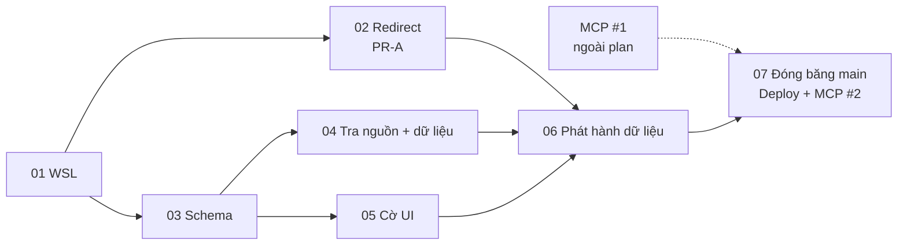

# Redirect 301, chữ Hán có nguồn, MCP #2

## Overview
Sau PR #11 site theo client Global nhưng: URL `/tra-cuu` cũ của 18 chiến pháp gộp đang 404; 31 chiến pháp chưa có hiệu ứng chữ Hán; chữ Hán không từ SGSDeck (29 `newTactics` + 3 dòng baseline cũ) không có nguồn; MCP production lệch dữ liệu. Plan làm phần sau MCP #1 theo thứ tự đã chốt: redirect → chữ Hán → deploy → MCP #2.

Bằng chứng: [reports/bang-chung.md](./reports/bang-chung.md). Tư vấn gốc đã được Astra rà (GO-with-fixes), kiểm tay, và red-team 4 góc (xem cuối file).

## Điều kiện tiên quyết (ngoài plan)
- [ ] MCP #1 đã chạy: `gh workflow run mcp-worker.yml --ref main -f production_sha=<SHA origin/main> -f confirm_production=true -f bootstrap_first_release=false -f rehearse_rollback=false`; `tqccl_get_entity` `tactic:lua-chay-ngun-ngut` → `tactic:han-thien-si-dia`. Không chặn phase 01–06; chặn phase 07.

## Goals
| # | Goal | Priority |
|---|------|----------|
| 1 | Mọi URL cũ của chiến pháp gộp (hiện 18 × vi/zh = 36) trả 301 thẳng tới mã giữ; URL mồ côi (8 chiến pháp + Hà Thị × 2 = 18) giữ 404 | P1 |
| 2 | 0 chiến pháp pending; mọi hiệu ứng chữ Hán không lấy từ SGSDeck có nguồn khai báo (hiện 31 + 29 + 3 = 63, tính từ dữ liệu) | P1 |
| 3 | Cờ bản dịch hiện trên site (hồ sơ vi + zh, thẻ liên quan zh, bảng nhóm zh) và trong MCP; meta/JSON-LD zh không dùng chữ Hán tự dịch | P1 |
| 4 | Pages và MCP production chạy cùng SHA tại thời điểm phát hành | P1 |

## Quyết định thiết kế
- **Redirect**: sinh trong `pipeline/lookup_route_handles.py` từ `ledger.retired.tactics` (slug cũ) + `data/tactics.json` `lookup.formerIds` (mã giữ) + `ledger.handles.tactics` (slug đích). Ghi `public/_redirects`, 301 tường minh, URL có `/` cuối. Không viết tay, không trang HTML, không 410. Số rule tính từ dữ liệu (2 × số cặp `formerIds`), không ghi cứng.
- **Nguồn gốc hiệu ứng do builder tính**: mỗi chiến pháp có một trong: `sgsdeck` (= `effectText` dùng được của SGSDeck), `zhEffects`, hoặc `missing`. Hiệu ứng lấy từ baseline cũ (`pipeline/lookup-inputs/tactics.json`, khi SGSDeck `待補充`/không có bản ghi) **không được phép xuất bản** nếu không có mục `zhEffects` → build dừng.
- **Đầu vào chữ Hán duy nhất** — khoá mới `zhEffects` trong `pipeline/lookup-client-tactics.json`, thay `newTactics[*].effectZh` (clean cutover):
  ```json
  "tactic:<id>": {"text": "<中文>", "viSha256": "<sha256 effectViet lúc gán>", "source": {"kind": "source", "ref": "https://…"} | {"kind": "capture", "note": "client TW 訓兵場 2026-10-17"} | {"kind": "translation"}}
  ```
  `viSha256` bắt buộc cho mọi loại: `effectViet` đổi → build dừng, buộc rà lại chữ Hán. `ref`/`note` chỉ ở đầu vào và field ledger riêng, **không ra dữ liệu công khai** (`docs/unified-lookup.md:14`).
- **Trường công khai**: `lookup.effectZhSource` = `null` (chữ Hán từ SGSDeck, hoặc không có chữ Hán) | `{"kind":"source"}` | `{"kind":"capture"}` | `{"kind":"translation"}`.
- **`capture`**: chỉ dùng cho 16 chiến pháp TROOP `tinh-*` (bằng chứng `gen.py:176`: chụp màn 訓兵場 client TW) khi 三略庫 không có trang khớp; giữ nguyên chữ hiện có; không gắn cờ. 13 `newTactics` khác và 3 dòng baseline: `source` hoặc `translation`.
- **Cờ** (chỉ `kind == "translation"`): hồ sơ chiến pháp (vi + zh, SSR + modal, nằm ngoài panel phiên bản); thẻ chiến pháp liên quan (chỉ zh); ô hiệu ứng bảng nhóm `/zh/tra-cuu/chien-phap/`. Meta description + JSON-LD trang zh của mục translation bỏ đoạn hiệu ứng. Giải thích đội (roster) để nguyên.
- **Promote**: manifest activation `paths: []`; code đi qua git (tiền lệ `plans/260913-2018-viet-hoa-toan-bo/phase-02-reviewed-publication.md:85`).
- **PR**: PR-A (phase 02) và PR-B (phase 03–06). Trong PR-B, đầu ra sinh nằm ở commit cuối riêng.
- **Đóng băng**: từ lúc merge PR-B tới khi MCP #2 xanh: không merge vào `main`, tạm dừng đăng/sửa bài blog (tránh `blog-publish` tự deploy Pages).

## Phases
| # | Phase | Status | Phụ thuộc |
|---|-------|--------|-----------|
| 1 | [Môi trường WSL và baseline](./phase-01-moi-truong-wsl.md) | Pending | — |
| 2 | [Redirect 301 sinh từ ledger](./phase-02-redirect-301.md) | Pending | 1 |
| 3 | [Schema effectZhSource và allowlist MCP](./phase-03-schema-effect-zh-source.md) | Pending | 1 |
| 4 | [Tra nguồn và chuyển dữ liệu chữ Hán](./phase-04-tra-nguon-chu-han.md) | Pending | 3 |
| 5 | [Cờ bản dịch trên giao diện](./phase-05-co-ban-dich-ui.md) | Pending | 3 |
| 6 | [Chuỗi phát hành dữ liệu và gate](./phase-06-chuoi-phat-hanh.md) | Pending | 2, 4, 5 |
| 7 | [Merge, deploy Pages, MCP #2, docs](./phase-07-deploy-mcp-docs.md) | Pending | 6, MCP #1 |



## Success Criteria
- [ ] `curl -sI` mọi URL nguồn trong `public/_redirects`: `301`, `location` khớp chính xác đích cùng locale, đích `200`; 18 URL mồ côi `404`; biến thể không `/` ghi riêng.
- [ ] `data/tactics.json`: 0 dòng `pending: true`; builder không còn chiến pháp nào có hiệu ứng ngoài SGSDeck mà thiếu `zhEffects`; số `effectZhSource != null` = số mục `zhEffects` = số dòng bảng `reports/nguon-chu-han.md`.
- [ ] Cờ hiện trong HTML tĩnh không JS và modal (vi + zh), thẻ liên quan zh, bảng nhóm zh; không mục `source`/`capture`/`null` nào mang cờ; meta/JSON-LD zh của mục translation không chứa đoạn hiệu ứng. Hành vi giữ cờ khi đổi phiên bản được kiểm bằng record giả 2 revision.
- [ ] Dữ liệu công khai và MCP không có `ref`, `note`, `viSha256`; MCP production `tqccl_get_entity` trả `profile.lookup.effectZhSource.kind`.
- [ ] Commit hash Pages (Cloudflare) = `production_sha` MCP #2 tại thời điểm phát hành.
- [ ] Gate xanh: Python unittest, `test:node`, `build`+`verify`+`test:dist`, `mcp-worker check`, Playwright, `lookup_route_handles --check`, `team_route_handles --check`, `site_localization check --stage public`, `report-zh-gaps --check`, `design-tokens --check`.
- [ ] `docs/deployment.md`, `docs/deployment-guide.md`, `docs/unified-lookup.md`, `docs/project-changelog.md` cập nhật.

## Ngoài phạm vi
`conflictsVi` (141 trống), `maxUsers` (14 trống), mở/chụp game, 410 hoặc Pages Function, đổi tên chiến pháp cũ trong ghi chú đội, cờ trong giải thích đội (roster).

## Ràng buộc
- Không sửa tay `data/tactics.json`, `lookup-manifest.json`, digest; chỉ qua builder/promote.
- Pipeline chạy trong bản sao Linux thật (WSL `~/w2`), không symlink; không đụng `~/w`.
- Không stage `plans/reports/research-2609*.md`.
- `production_sha` = `origin/main` HEAD lúc dispatch.
- Không gắn nhãn đồng loạt: mỗi mục `zhEffects` có kết quả tra riêng trong bảng.
- Không đăng ký chuỗi cờ vào `UI_LITERAL_OBLIGATIONS` (không bắt buộc); chỉ repin hash `sourceFiles`.

## Điều kiện dừng hỏi
Token Cloudflare/preflight lỗi; release, promote hoặc deploy lỗi không giải thích được; thao tác force-push/viết lại lịch sử/xoá dữ liệu; sửa ngoài repo hoặc ngoài phạm vi trên (gồm Redirect Rule ở zone Cloudflare); `main` không đóng băng được.

## Red Team Review

### Session — 2026-10-20
**Findings:** 15 sau khi gộp từ 34 (15 accepted, 0 rejected; 2 cần quyết định người dùng đã trả lời)
**Severity breakdown:** 2 Critical, 7 High, 6 Medium
**Reviewer:** Security Adversary, Failure Mode Analyst, Assumption Destroyer, Scope & Complexity Critic (code-reviewer)

| # | Finding | Severity | Disposition | Applied To |
|---|---------|----------|-------------|------------|
| 1 | 3 dòng chữ Hán baseline cũ (`nhanh-tri-dong-nao`, `luc-luc-thuong-quoc`, `vo-song-thuong-tuong`) bị gắn `null` = SGSDeck | Critical | Accept | plan, 03, 04, 06 |
| 2 | `ref` công khai vi phạm `docs/unified-lookup.md:14`; `ref` sgsdeck làm đỏ gate MCP | Critical | Accept | plan, 03, 07 |
| 3 | Manifest activation `beforeHash` từ HEAD `main` → promote lỗi | High | Accept | 06 |
| 4 | Bước `build_recommended_reference` sai CLI, ghi đè `current.json` | High | Accept | 06 |
| 5 | Rebase xung đột file sinh; transaction id cố định | High | Accept | 01, 06 |
| 6 | SHA Pages/MCP lệch khi `main` đổi hoặc blog-publish | High | Accept | plan, 07 |
| 7 | 301 kiểm lần đầu trên production, bị cache lâu dài | High | Accept | 02, 07 |
| 8 | Nội dung forum/URL kiểm yếu; chỉ rà mẫu 10 | High | Accept | 03, 04 |
| 9 | 16 TROOP chụp client TW không có loại nguồn phù hợp | High | Accept (người dùng: thêm `capture`) | plan, 03, 04 |
| 10 | Bề mặt zh khác hiện chữ dịch không cờ | High | Accept (người dùng: bảng zh có cờ + bỏ khỏi meta) | plan, 05 |
| 11 | Phase 03 gắn tạm 29 mục là `translation` | Medium | Accept | 03, 04 |
| 12 | `source` không gắn `effectViet` → âm thầm cũ | Medium | Accept (`viSha256` mọi loại) | plan, 03 |
| 13 | Số 36 ghi cứng trong test | Medium | Accept | 02 |
| 14 | `UI_LITERAL_OBLIGATIONS` không bắt buộc; đổi phiên bản không kiểm được trên dữ liệu thật | Medium | Accept | 05, 06 |
| 15 | Phase 02 nhánh lỗi chết, test JS trùng, `make_data` thiếu `lookup`; thiếu docs/file sinh (`deployment-guide.md`, `zh-gaps.md`), `books-dict.json` không qua promote, helper đặt sai module, rủi ro cache ngược | Medium | Accept | 02, 05, 06, 07 |

### Whole-Plan Consistency Sweep
- Files reread: plan.md, phase-01 … phase-07, reports/bang-chung.md
- Decision deltas checked: 12 (63 thay 60; `capture`; `viSha256` mọi loại; `ref` riêng tư; `paths: []`; bỏ build_recommended_reference; commit sinh riêng + transaction id mới; đóng băng main; `wrangler pages dev`; bỏ UI_LITERAL; bỏ test JS trùng; bề mặt cờ zh)
- Reconciled stale references: xem từng phase (marker `<!-- Updated: Red Team 2026-10-20 -->`)
- Unresolved contradictions: 0

## Validation Log

### Session 1 — 2026-10-20
**Verification:** bỏ qua bước kiểm lại vì Red Team đã có bằng chứng (RTSecurity fact-check 42 claim: 38 pass, 4 fail — cả 4 đã sửa ở phase 02/03/04/07).

| # | Câu hỏi | Quyết định | Áp vào |
|---|---------|------------|--------|
| 1 | Deploy Pages ngay sau PR-A hay gộp với PR-B? | Deploy ngay, chạy ma trận HTTP ngay | Phase 02 bước 7 |
| 2 | Câu cờ bản dịch | vi “Hiệu ứng chữ Hán dịch từ tiếng Việt, chưa đối chiếu” / zh “中文效果译自越南语，未经核对” | Phase 05 (giữ nguyên) |
| 3 | Host nguồn hợp lệ | `sanzhan.slgsim.com`, `forum.gamer.com.tw` | Phase 03, 04 (giữ nguyên) |

### Whole-Plan Consistency Sweep
- Files reread: plan.md, phase-01 … phase-07
- Decision deltas checked: 1 (deploy sớm PR-A thành bắt buộc)
- Reconciled stale references: 1 (phase 02 bước 7 + Todo)
- Unresolved contradictions: 0

### Session 2 — 2026-10-21 (thực thi, `ak:cook --advice`)
| # | Câu hỏi | Quyết định | Áp vào |
|---|---------|------------|--------|
| 1 | 三略庫 chỉ hiện số đầy cấp: đủ làm `source`? | Không (tư vấn: lựa chọn B). `source` chỉ khi trang có đủ dải cấp; 31 mục lấy từ bài Bahamut 戰法一覽【S1-S9】 | Phase 04 |
| 2 | `design-tokens --check` đỏ sẵn trên `main` | Người dùng: sửa trong PR-B (`.cm-auth-notice-close` dùng token) | PR #22 |
| 3 | MCP #1 chưa chạy | Người dùng: chạy ngay; lần 1 dừng ở Playwright timeout trước deploy, người dùng duyệt rerun một lần → xanh | Điều kiện tiên quyết |
| 4 | Sửa theo review khi đã có commit sinh | Người dùng: force-push PR #22 (transaction `-r2`, rồi `-r3` sau khi `main` có PR #24) | Phase 06 |
| 5 | Review Astra: MERGE-WITH-FOLLOWUPS | Người dùng: merge ngay, follow-up sau | Phase 07 |

Kết quả: PR #19 (`6b17d23`) và PR #22 (`1fa81ab`) đã merge; Pages `cb91471a` và Research MCP `62cba122…` cùng SHA `1fa81ab`; ghi ở `docs/deployment.md`.

Follow-up (theo quyết định #5):
- Đã sửa 2026-10-22: `tactic:dam-tam`, `tactic:tinh-hoa`, `tactic:truy-thuong` (`source`) thêm dải tỉ lệ phát động theo cấp từ cột tỉ lệ của cùng dòng Bahamut; test dữ liệu `ZhEffectsDataTest`.
- Đã sửa 2026-10-22: e2e bấm nút phiên bản thật ở hộp thoại và trang riêng trên bản ghi `translation` hai phiên bản.
- Không gọi được `tqccl_get_entity` production có xác thực từ máy này (không có bearer); bằng chứng là verifier của workflow + release ID trùng với CLI cục bộ.
