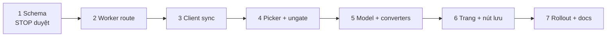

# Đồng bộ kho (#21) và Đội của tôi (#23)

## Overview

Kho của `/goi-y-doi-tu-kho/` chỉ nằm trong `localStorage` (`tqccl.rosterRecommend.scanState.v1`, `js/roster-scan-state.js:3`), và người chơi đang quản lý đội bằng Google Sheets. Plan này làm hai việc nối tiếp, dùng chung một bảng D1 và một client đồng bộ:

- **#21**: đồng bộ kho lên `community-worker` qua `/api/roster`, schema có hộp kho (`boxId`) ngay từ đầu; bảng chọn nhanh (lọc + chọn tất cả); gỡ chặn của `initRosterRecommend` khi Worker AI chưa cấu hình (`js/roster-recommend-ui.js:100`).
- **#23**: trang `/doi-cua-toi/` bắt buộc đăng nhập Google; hộp kho tự đặt tên, nhóm (mặc định Khai Hoang, Ghép Team), đội là bản sao độc lập lưu từ 4 nguồn (Gợi ý, chi tiết Đội chuẩn/Đội khác, chi tiết Khai hoang, Soi đội); trình soạn có cấu trúc + cột chữ tự do; dấu "chưa có trong kho"; cảnh báo trùng tướng.

Mẫu dùng lại: đồng bộ Theo dõi chiêu mộ (`community-worker/src/routes/recruit.ts`, `migrations/0004_recruit.sql`, `js/recruit-sync.js`, đóng dấu Lamport ở `js/recruit-tracker-store.js:68-70`). Route và client roster viết riêng, không sửa `recruit-sync`.

## Goals

| # | Goal | Priority |
|---|------|----------|
| 1 | Kho Gợi ý đội bền và theo người dùng qua thiết bị khi đăng nhập; chưa đăng nhập vẫn chạy local như cũ | P1 |
| 2 | Nhập kho tay hàng loạt bằng lọc + chọn tất cả; công cụ dùng được khi Worker AI chưa cấu hình | P1 |
| 3 | Người chơi bỏ được Google Sheets: lưu, soạn, nhóm đội trong hộp kho trên web | P1 |
| 4 | Schema D1 chỉ migrate một lần cho cả #21 và #23 | P1 |

## Phases

| # | Phase | Issue | Status | Effort | Depends on |
|---|-------|-------|--------|--------|------------|
| 1 | [Chốt schema và hợp đồng dữ liệu (điểm dừng duyệt)](./phase-01-schema-contract.md) | #21 #23 | Done | 0.5d | — |
| 2 | [Worker: bảng `roster_records` và route `/api/roster`](./phase-02-worker-roster-route.md) | #21 | Done | 2d | 1 |
| 3 | [Client: đồng bộ kho theo hộp](./phase-03-client-roster-sync.md) | #21 | Done | 2.5d | 2 |
| 4 | [Client: bảng chọn nhanh và gỡ chặn Worker AI](./phase-04-quick-picker-ungate.md) | #21 | Done | 1.5d | 3 |
| 5 | [Đội của tôi: mô hình, bộ chuyển nguồn, lưu dở qua OAuth](./phase-05-my-teams-model.md) | #23 | Done | 3d | 3, 4 |
| 6 | [Đội của tôi: trang, trình soạn, nút lưu ở 4 nguồn](./phase-06-my-teams-ui.md) | #23 | Done | 2.5d | 5 |
| 7 | [Rollout và tài liệu](./phase-07-rollout-docs.md) | #21 #23 | Done | 0.5d | 6 |

Plan song song cần phối hợp: `plans/261021-0628-doi-cong-dong/` (Đội cộng đồng) giữ migration `0008`–`0010` và sửa chung `COMMUNITY_PAGES`, `public/_headers`, `community-auth.js`, bản dịch. Plan này dùng `0011_roster.sql`; mỗi phase rebase lên `main` trước khi publish lại bản dịch để không ghi đè generation của plan kia.

Các phase chạy nối tiếp: phase 3–6 cùng sửa `src/lib/public-artifact-manifest.mjs` và `pipeline/site-localization-policy.json`, mỗi phase kết thúc bằng một lượt "Publish lại bản dịch hiển thị" (`docs/deployment-guide.md:251-271`) để `npm run check/build` xanh.

## Key Decisions

Chốt qua advise:
- Đơn vị gộp là từng bản ghi nhỏ (món kho, mùa, đội khóa, món bù, nhóm, đội, hộp); sửa hai thứ khác nhau trên hai máy không đè nhau.
- Một route, một bảng cho mọi kind. Một client roster (`js/roster-sync.js`) cho cả Gợi ý và Đội của tôi.
- Gợi ý chạy local khi chưa đăng nhập; lần đầu có cloud thì hỏi rồi gộp vào hộp `main`.
- Đội của tôi bắt buộc đăng nhập, không chế độ offline cho đội.
- Đội là bản sao độc lập có `source`; bản gốc đổi chỉ báo, không ghi đè.
- Món chưa có trong kho được đánh dấu, không chặn. Không tạo đội trống. Không chia sẻ.

Thêm từ red-team:
- Đóng dấu Lamport, đẩy theo dirty set; server chặn `updatedAt` vượt `now + 5 phút` và trả `rejected` từng bản ghi thay vì 400 cả batch.
- Cột `deleted`; quota và cap chỉ tính bản ghi sống, kiểm trong cùng câu ghi; xóa hộp thì server xóa hẳn bản ghi con.
- ID món kho suy từ tên bằng resolver của engine (kho local không lưu `canonicalId`).
- Hash nguồn tính trên trường thô và được chép khi lưu; index phục vụ bằng Astro endpoint.

## Non-goals

Nhập sheet/CSV/xlsx, chia sẻ/công khai đội, cấp tài khoản game, tạo đội trống, kho trang bị có cấu trúc, kiểm dữ liệu cột chữ tự do (ngoài giới hạn byte), chế độ offline cho đội, tách `recruit-sync` thành module chung, #20 (Độ phủ kho).

## Success Criteria

- [x] Phase 1 schema được người dùng duyệt trước khi viết migration.
- [x] Chưa đăng nhập: Gợi ý đội chạy y như hiện tại với kho local. <!-- phase 3: smoke trình duyệt khách thêm món, 0 request /api/roster, khóa local đúng; tests-js/roster-scan-state + roster-* xanh -->
- [x] Đăng nhập lần đầu, đồng ý gộp: kho local (kể cả món thêm tay, không có `canonicalId`) vào hộp `main`; máy thứ hai thấy cùng kho; món đã xóa trên cloud không sống lại. <!-- phase 3: smoke hai trình duyệt cùng user (wrangler dev + pages dev, D1 local); store test 4 cho bản xóa -->
- [x] Bảng chọn: lọc rồi "Chọn tất cả N mục" thêm đúng N món; công cụ chạy khi cấu hình AI rỗng (chỉ ẩn đọc ảnh và giải thích AI). <!-- phase 4: roster-picker.test.mjs (10 ca, gồm ca 6 gộp 36 owned qua fake server); E2E 7 (config.js REPLACE_ME) và 8 xanh -->
- [x] Lưu từ 4 nguồn (kể cả biến thể Đội khác/Khai hoang) vào hộp, đúng nhóm, dữ liệu như nguồn; chưa đăng nhập thì lưu sau OAuth và không mất khi lưu lỗi. <!-- phase 6: tests-e2e/my-teams.spec.mjs #2–#7 (OAuth một lần, POST 500 giữ bản lưu dở, key x~v, chip Khai hoang, Gợi ý đội, Soi đội); smoke wrangler dev + pages dev: 5 nguồn lưu từ UI vào D1 local, đúng nhóm -->
- [x] Món chưa có trong kho hiện dấu; trùng tướng cảnh báo trừ cặp "thay thế cho"; xung đột/bị từ chối báo `role="alert"` và giữ nội dung. <!-- phase 6: my-teams.spec #8–#11 -->
- [x] `npm run check`, `npm run build`, `npm run verify`, `npm run test:dist`, `npm run test:node`, `cd community-worker && npx vitest run && npx tsc --noEmit` đều qua. <!-- phase 6: check 0 lỗi; test:node 704; test:dist 52; vitest 570; Playwright 187 -->
- [x] Docs rollout có thứ tự D1 `0011_roster.sql` → Worker → Pages và rollback đúng hành vi client cũ; README, changelog, Quyền riêng tư cập nhật. <!-- phase 7: deployment-guide.md § roster_records, community-worker.md, README, changelog, PrivacyPage vi/zh; gates xanh: check 0 lỗi, build 5025 trang, verify, test:dist 52, test:node 704, vitest 570 + tsc. Việc rollout thật và kiểm Google OAuth/D1 production do người dùng làm, nằm ngoài tiêu chí này -->

> Trạng thái `done` nghĩa là code, test và docs xong và nằm trên worktree chưa commit. Rollout lên production (migration D1 `0011`, deploy Worker, deploy Pages, một lượt đăng nhập Google thật và một lượt lưu/đọc trên production) là việc của người dùng, chưa thực hiện.

## Red Team Review

### Session — 2026-10-21
**Findings:** 39 thô từ 4 reviewer, gộp còn 16 (15 accepted, 1 rejected)
**Severity breakdown:** 3 Critical, 9 High, 4 Medium

| # | Finding | Severity | Disposition | Applied To |
|---|---------|----------|-------------|------------|
| 1 | Kho local không có `canonicalId`; gộp lần đầu đẩy 0 món | Critical | Accept | Phase 1, 3, 4 |
| 2 | Thiếu manifest `PUBLIC_ARTIFACTS`, re-pin bản dịch, `COMMUNITY_PAGES`, trang Quyền riêng tư; phase 4∥5 sai | Critical | Accept | plan.md, Phase 3–7 |
| 3 | Bản xóa giữ payload, tính quota, cap lách được, không dọn | Critical | Accept | Phase 1, 2 |
| 4 | Blob `tool` 4 KiB vượt trần, ghi đè lẫn nhau, trái #21 | High | Accept | Phase 1, 2, 3 |
| 5 | Giới hạn ký tự vs trần byte; một bản ghi hỏng kẹt cả batch | High | Accept | Phase 1, 2, 3, 5 |
| 6 | Lệch đồng hồ làm mất bản sửa, báo "đã lưu" sai | High | Accept | Phase 1, 2, 3, 5, 6 |
| 7 | Gộp lần đầu hồi sinh món đã xóa, chạy lại khi đổi tài khoản, lẫn kho máy dùng chung | High | Accept | Phase 1, 3 |
| 8 | 401 chuyển sang kho local cũ, mất sửa | High | Accept | Phase 3, 7 |
| 9 | Biến thể Đội khác chỉ có lúc chạy; Khai hoang đổi biến thể không tải lại; `khVariant` sai | High | Accept | Phase 1, 5, 6 |
| 10 | Đội từ Gợi ý thiếu binh thư, lệch ô, luôn "đã cập nhật" | High | Accept | Phase 1, 5 |
| 11 | Mô hình đội không khớp dữ liệu (đội 2 tướng, unresolved, "A/B", bond) | High | Accept | Phase 1, 5 |
| 12 | Lưu dở OAuth bị xóa trước khi lưu xong; chưa có hộp `main` | High | Accept | Phase 5, 6 |
| 13 | Cache vượt dung lượng, cursor/cache rời nhau, hai client cho cùng API, refactor `recruit-sync` ngoài phạm vi | Medium | Accept | Phase 2, 3, 5 |
| 14 | Server không kiểm `data`; link `javascript:`; JSON nhúng chưa escape | Medium | Accept | Phase 2, 5, 6 |
| 15 | Sai chi tiết: 401 không phải 403; "Tự mang"/null; `cost` chuỗi; `isAnalyzeConfigured` luôn đúng ở prod; smoke đăng nhập; rollback | Medium | Accept | Phase 2, 3, 4, 7 |
| 16 | Bỏ cột `box_id` | Medium | Reject | — cần cho xóa con phía server và kiểm hộp tồn tại |

Đề xuất "bỏ xóa hộp/nhóm vì issue không yêu cầu" là câu hỏi phạm vi, chuyển sang Validation.

### Whole-Plan Consistency Sweep

- Đã thay mọi chỗ nhắc `tool` bằng `season`/`locked`/`override`; `record-sync`/tách `recruit-sync` đã bỏ khỏi phase 3 và Non-goals ghi rõ.
- `khVariant` đã bỏ; biến thể Đội khác xử lý ở phase 1, 5, 6.
- Thứ tự phase nối tiếp; phase 5 phụ thuộc 3 và 4 (dùng `roster-picker`, `roster-sync`); đã bỏ câu "phase 4 và 5 song song".
- `source` dùng `{kind, key, contentHash}` thống nhất ở phase 1, 5, 6 (issue #23 ghi `{kind, id, version}`; tên mới được nêu ở phase 1 để người dùng duyệt).
- Không còn mâu thuẫn chưa giải quyết.

## Validation Log

### Session 1 — 2026-10-21

### Verification Results
- Claims checked: kiểm qua red-team (4 reviewer, Full tier) và kiểm tay các bằng chứng chính: `src/lib/public-artifact-manifest.mjs:60,68`, `pipeline/site-localization-policy.json` (18 lần khớp các file sẽ sửa), `js/config.js:4-20`, `scripts/verify-astro-dist.mjs:78`, `src/components/pages/PrivacyPage.astro:148-157`, `docs/deployment-guide.md:251-271`.
- Verified: tất cả trích dẫn còn lại trong plan | Failed: 0 | Unverified: 0
- Tier: Full
- Failures: không (hai lệch dòng nhỏ đã sửa: `canonicalByShown` ở `:135`; resolver build ở `team-detail-pages.ts:102` là `createLookupIdResolver`).

### Decisions
| # | Câu hỏi | Quyết định | Ảnh hưởng |
|---|---|---|---|
| 1 | Giữ xóa hộp và xóa nhóm (ngoài chữ của #23)? | Giữ cả hai | Phase 1 (xóa con phía server), Phase 2 test 11–12, Phase 6 UI xóa có xác nhận |
| 2 | Hỏi trước khi gộp kho local lần đầu? | Hỏi trước khi gộp | Phase 1 bước gộp, Phase 3 test 2–5 |

### Whole-Plan Consistency Sweep
- Đã bỏ câu "chờ xác nhận ở bước validate" ở phase 1 và phase 6; không còn thuật ngữ cũ (`tool`, `khVariant`, `record-sync`, 403).
- Không còn mâu thuẫn chưa giải quyết.

### Session 2 — 2026-10-21 (Phase 1 duyệt schema)

Số đo trong `docs/roster-sync.md` § Số đo. Lệch so với bản nháp: `notes` 2 400 → 2 000 B (đội xấu nhất 17 389 → 15 781 B); byte trường chữ đếm sau JSON escape; thêm trần `rawName` 80 B, `userAlternatives` ≤ 6, `source.key` 128 B, id ≤ 64 B, đội khóa (`teamName` 180 B, ≤ 3 tướng, ≤ 6 chiến pháp); server từ chối ký tự điều khiển trừ `\n`/`\t`; mã `default_protected`, `quota`, `cap`.

| # | Câu hỏi | Quyết định | Ảnh hưởng |
|---|---|---|---|
| 1 | Duyệt `docs/roster-sync.md` để viết migration? | **Duyệt** | Mở phase 2 |

## Astra Audit

### Session — 2026-10-21
Báo cáo: [reports/astra-audit.md](./reports/astra-audit.md) (`gpt-6-astra`, effort high, chỉ đọc). 16 phát hiện; cả 16 được kiểm lại bằng code/dữ liệu thật và đều đúng; H2 và H9 hạ xuống Medium. Người dùng duyệt áp dụng tất cả.

| # | Phát hiện | Mức (sau kiểm) | Áp vào |
|---|---|---|---|
| C1 | Xóa hộp đến muộn vẫn xóa dữ liệu con | Critical | Phase 1 (Xóa), Phase 2 test 14–18 |
| H1 | `accepted` tổng không phân biệt gửi lại / xung đột; dirty mất bản sửa đang chờ; hòa Lamport | High | Phase 1 (kết quả từng bản ghi), Phase 2 test 4–6, 11; Phase 3 test 10–12; Phase 5, 6 |
| H3 | Hai tab cùng ghi cache đè mất thay đổi | High | Phase 1 (Cache giữa nhiều tab), Phase 3 test 15 |
| H4 | Gộp lần đầu bỏ sót đội khóa, món bù | High | Phase 1 (Gộp), Phase 3 test 3–5 |
| H5 | Xóa nhóm không nguyên tử; nhóm mặc định chỉ cho `main` | High | Phase 1 (Xóa), Phase 2 test 19–21, Phase 3, 6 |
| H6 | Lưu từ Gợi ý ra đội gốc thay vì đội đang hiện | High | Phase 1 (bảng ghép trường), Phase 5 test 10 |
| H7 | Khai hoang mất giai đoạn, chủ tướng, ghi chú | High | Phase 1 (bảng ghép trường), Phase 5 test 9b |
| H8 | Test đồng thời cần sửa harness D1 giả (đã có trong plan Đội cộng đồng) | High | Phase 2 (prerequisite) |
| H2 | Đổi tài khoản ở tab khác đẩy kho A vào B | Medium | Phase 1, Phase 2 test 10, Phase 3 test 8 |
| H9 | Bản xóa tăng không giới hạn | Medium | Phase 1 (Giới hạn), Phase 2 test 26–27 |
| M1 | Đổi `boxId` lách cap nhóm | Medium | Phase 1, Phase 2 test 22 |
| M2 | Resolver không kiểm từ điển; tên Hán ném lỗi | Medium | Phase 1, Phase 3 test 1–2 |
| M3 | Endpoint index phải vào allowlist dist và `_headers` | Medium | Phase 5, Phase 6 bước 1 |
| M4 | Link nguồn thiếu bảng đường dẫn `{r,k}` và biến thể | Medium | Phase 1, Phase 6 test 9c |
| M5 | Bảng chọn kho không dùng được cho trình soạn | Medium | Phase 4 (policy `inventory`/`editor`), Phase 6 |
| M6 | Thiếu ghép phương án thay/cộng điểm/ghi chú; hash không phủ | Medium | Phase 1, Phase 5 test 7–8, 12 |

Sửa trích dẫn: `PrivacyPage.astro`, `community-api.js`, `community-auth.js` không bị ghim bản dịch (phase 3, 6 đã sửa).

### Whole-Plan Consistency Sweep (sau Astra)
- `accepted`/`rejected` đã thay bằng `results[].outcome` ở phase 1, 2, 3, 5, 6.
- `ensureDefaults()` đã thay bằng `ensureBoxDefaults(boxId)` ở phase 3, 5, 6.
- Xóa nhóm chuyển từ client sang server ở phase 1, 2, 6.
- Effort: 10.5d → 12.5d.
- Không còn mâu thuẫn chưa giải quyết.

<!-- slug: dong-bo-kho-va-doi-cua-toi -->
