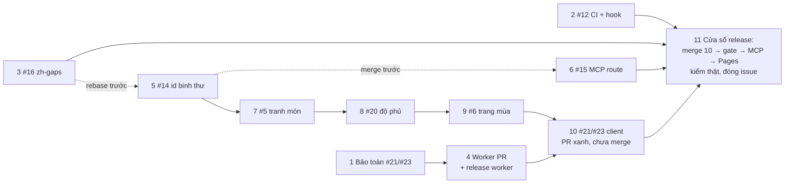

# Đợt gom 9 issue

## Overview

Đợt này xử lý 9 issue mở (#5, #6, #12, #14, #15, #16, #20, #21, #23). Mỗi issue hoặc nhóm issue có PR riêng, merge dần vào `main`. Mục tiêu là giảm số lần release ba khâu tốn công: Research MCP, community-worker + D1, Pages. Không nhằm giảm số PR.

Brief đã chốt qua `ak:advise` và hai lượt review độc lập: [reports/brief.md](./reports/brief.md), [reports/fable-review-route.md](./reports/fable-review-route.md), [reports/astra-review-route.md](./reports/astra-review-route.md). Bằng chứng code nằm trong 5 báo cáo scout ở `reports/scout-*.md`.

**#21/#23 đã được code xong nhưng chưa commit.** Worktree `../worktrees/CamNangTQCCL-dong-bo-kho-va-doi-cua-toi` (nhánh `feat/dong-bo-kho-va-doi-cua-toi`, base `1fa81ab`) có khoảng 272 path thay đổi chưa commit; journal `plans/journals/261022-cook-dong-bo-kho-doi-cua-toi.md` trong worktree ghi phase 1–7 đã xong, schema đã được duyệt, cổng kiểm xanh. Plan gốc `plans/261021-0632-dong-bo-kho-va-doi-cua-toi/` (bản trong worktree là bản đúng; bản chưa track ở checkout chính đã cũ) là tham chiếu cho phần đã làm. Đợt này chỉ **bảo toàn, tách và đưa code đó lên `main`**, không viết lại.

## Goals

| # | Goal | Priority |
|---|------|----------|
| 1 | Đóng 9 issue, mỗi issue có PR và bằng chứng kiểm | P1 |
| 2 | Research MCP release 1 lần, D1 + community-worker release 1 lần, Pages release chính thức 1 lần | P1 |
| 3 | Mọi commit trên `main` deploy được lên production bất cứ lúc nào (blog vẫn tự deploy Pages) | P1 |
| 4 | Id và slug hiện có không đổi; id binh thư không còn suy từ tên Việt | P1 |

## Phases

| # | Phase | Issue | Lane | Effort | Depends on |
|---|-------|-------|------|--------|------------|
| 1 | [Bảo toàn code #21/#23](./phase-01-bao-toan-code-21-23.md) | #21 #23 | — | 0.25d | — |
| 2 | [CI và pre-push hook](./phase-02-ci-pre-push-hook-12.md) | #12 | tự do | 0.5d | — |
| 3 | [Báo cáo zh-gaps](./phase-03-zh-gaps-16.md) | #16 | tự do | 0.25d | — |
| 4 | [Worker `/api/roster` và release worker](./phase-04-worker-roster-release-21.md) | #21 | tự do | 0.5d | 1 |
| 5 | [Đóng băng id binh thư](./phase-05-dong-bang-id-binh-thu-14.md) | #14 | nối tiếp | 2.5d | — |
| 6 | [MCP route sang trang riêng](./phase-06-mcp-route-trang-rieng-15.md) | #15 | merge sau 5 | 1d | 5 (merge) |
| 7 | [Đội tranh món trên Gợi ý kho](./phase-07-doi-tranh-mon-5.md) | #5 | nối tiếp | 1d | 5 |
| 8 | [Độ phủ kho theo tier](./phase-08-do-phu-kho-20.md) | #20 | nối tiếp | 1.5d | 7 |
| 9 | [Trang mùa Đội chuẩn](./phase-09-trang-mua-doi-chuan-6.md) | #6 | nối tiếp | 2d | 8 |
| 10 | [Client kho và Đội của tôi](./phase-10-client-kho-doi-cua-toi-21-23.md) | #21 #23 | nối tiếp; merge trong cửa sổ release | 2.5d | 4, 5, 9 |
| 11 | [Release cuối đợt và đóng issue](./phase-11-release-cuoi-dot.md) | tất cả | — | 1d | 2, 3, 6, 10 |

## Tiến độ

| # | Nhánh | PR | Trạng thái | SHA merge / ghi chú |
|---|-------|----|------------|---------------------|
| 1 | `feat/dong-bo-kho-va-doi-cua-toi` | — | done | snapshot `a4cf6c1` (272 path, quét secret sạch), đã push, không PR |
| 2 | `feat/ci-pre-push-hook` | #29 | merged | `7c812a6`; Actions hết phút → cổng `check:repository` chạy local trên head `e000cad` (mcp 544, test:dist 50, e2e 540, test:node 639, unittest 459, worker 167) xanh; build+verify sau merge xanh |
| 3 | `feat/zh-gaps-docs` | #27 | merged | `c82f8fa`; CI run `39785389095` xanh; build+verify sau merge xanh |
| 4 | `feat/roster-worker` | #28 | merged (bước 1–6) | `18099d1`; build+verify sau merge xanh; bước 7–8 (D1 `0011` remote, deploy worker, kiểm production) chờ người dùng |
| 5 | `feat/dong-bang-id-binh-thu` | #31 | merged | `edd9f08` (mốc rollback hàng nối tiếp); cổng local trên head `c69a5cb` (mcp 550, test:dist 51, e2e 540, test:node 650, unittest 473, worker 167) xanh; build+verify sau merge xanh |
| 6 | `feat/mcp-route-trang-rieng` | #30 | merged | `c95bdf1`; rebase lên 5, sinh lại `workflow-build.ts`; cổng local trên `bdd09ea` (mcp 556, e2e 538 + 2 flaky ngoài phạm vi, test:node 650, unittest 473) xanh; build+verify sau merge xanh |
| 7 | `feat/doi-tranh-mon` | #33 | merged | `444c791` (mốc rollback hàng nối tiếp); cổng local trên `574441d` (mcp 556, test:dist 51, e2e 546, test:node 657, unittest 473) xanh; build+verify sau merge xanh |
| 8 | `feat/do-phu-kho` | #34 | merged | `6ef0395` (mốc rollback hàng nối tiếp); cổng local trên `31b3a45` (mcp 556, test:dist 51, e2e 550 + 1 flaky ngoài phạm vi, test:node 671, unittest 473) xanh; build+verify sau merge xanh |
| 9 | `feat/trang-mua-doi-chuan` | #35 | merged | `5538533` (mốc rollback hàng nối tiếp; base Stage B của CĐ-B và phase 10); cổng local trên `a75a99a` (test:dist 57, e2e 555, test:node 684, unittest 475) xanh; build+verify sau merge xanh; comment quyết định trên #6 |
| 10 | `feat/roster-client` | #36 | PR mở, KHÔNG merge | head `b5e469a` trên `5538533`; cổng local đầy đủ xanh (mcp 556, test:dist 59, e2e 582, test:node 787, unittest 475, worker 167); merge ở phase 11 bước 2, sau deploy worker và sau CĐ-B (khi đó rebase + chạy lại chuỗi publish) |
| 11 | — | — | pending | cần người dùng (release production) |
| CĐ | `feat/doi-cong-dong-worker` (A), `feat/doi-cong-dong-cong-khai` (B) — plan `261022-1145` | A #32; B chưa mở | A merged; B Stage A xong | A `a7e217b` (worker 595/595, build+verify sau merge xanh). B: rebase lên commit merge `feat/trang-mua-doi-chuan` (base Stage B), chạy chuỗi publish, merge trong cửa sổ release ngay sau deploy worker, trước phase 10. Worker của A gộp vào lần release community-worker duy nhất. |

Ghi chú thực thi (2026-10-22):
- GitHub Actions hết phút giữa đợt; theo quyết định của người dùng, từ PR #29 cổng CI được thay bằng đúng lệnh của job `credential-free-release-gate` chạy local (`npm ci` root/worker/mcp-worker, `build:worker-assets`, `CI=true npm run check:repository`) trên head PR đã chứa `main`, từng PR một; kết quả dán vào PR. `schedule` hằng tuần của #12 sẽ không chạy cho tới khi Actions có phút lại.
- Phase 10: PR mở khi worker chưa release (bước 1 của phase 10 đỏ có chủ đích); PR không được merge trước cửa sổ release.

## Lanes và ràng buộc thứ tự

- **Hàng nối tiếp (phase 5 → 7 → 8 → 9 → 10):** mỗi phase sửa file bị ghim sha256 trong `pipeline/site-localization-policy.json` `sourceFiles`, nên phải chạy lại chuỗi "Publish lại bản dịch hiển thị" (`docs/deployment-guide.md:251-271`). Chuỗi này sinh một generation mới trong `src/data/recommended-reference/` và đổi `generationId` trong `pipeline/team-route-handles.json`. Hai nhánh song song cùng sửa file ghim sẽ xung đột generation. Mỗi PR rebase lên `main` mới nhất rồi mới chạy chuỗi.
- **Nhóm tự do (phase 2, 3, 4):** không đụng file ghim, không đụng `semanticFiles` của MCP. Làm và merge bất cứ lúc nào. Phase 3 đổi `npm run verify`; các PR hàng nối tiếp rebase lên phase 3 trước khi chạy CI lần cuối.
- **Phase 6 (#15):** không đụng file ghim, nhưng sửa file trong `mcp-worker/workflow-source-manifest.json` `semanticFiles`, cũng như phase 5 (`js/lookup-ids.js`, `js/analyze-map.js`, `js/season-context.js`, `mcp-worker/src/data/entity-identity.ts`) và phase 10 (`js/roster-scan-state.js`). Ba PR này merge từng cái một; mỗi lần chạy `cd mcp-worker && npm run generate:workflow-build` trên code đã gộp. Không chọn một phía khi `mcp-worker/src/generated/workflow-build.ts` xung đột.
- **Client gọi `/api/roster` (phase 10) chỉ vào `main` sau khi worker đã chạy trên production (phase 4), và chỉ merge trong cửa sổ release của phase 11** để lần đầu lên production có người theo dõi. `pages-deploy.yml` build `main` mỗi lần xuất bản blog (`community-worker/src/routes/posts.ts:139-156`, `.github/workflows/pages-deploy.yml:6-14`).
- **Invariant toàn đợt:** mọi PR merge vào `main` phải tự chạy được trên production. Không có branch protection, nên mỗi PR theo "Quy tắc merge PR" ở phase 2: cập nhật nhánh theo `main`, chờ CI xanh lại, merge, rồi `npm ci && npm run build && npm run verify` trên đúng SHA đã merge. Pages có thể bị blog deploy giữa đợt; điều này đã được chấp nhận. Sau mỗi lần đăng/gỡ blog, kiểm run `pages-deploy` xanh (giao diện admin chỉ báo dispatch thành công, `community-worker/src/routes/posts.ts:156`).

## Mốc rollback

- Trước khi merge PR đầu tiên của đợt: ghi SHA `main` (hiện `5b6014a`) và deployment ID Pages đang chạy vào `docs/deployment.md` làm mốc trước đợt.
- Sau mỗi merge của hàng nối tiếp (phase 5, 7, 8, 9, 10): ghi SHA đã merge vào PR và vào bảng tiến độ của plan này.
- Đơn vị rollback của hàng nối tiếp: revert các merge theo thứ tự ngược về một SHA đã ghi, hoặc sửa tiến bằng PR mới + chuỗi publish. Không revert riêng một PR giữa hàng (xung đột generation bản dịch và các file pin một dòng).
- Trước khi merge phase 10: lấy bookmark D1 mới (phase 11 bước 1).
- Không đăng blog trong lúc rollback.

## Quyết định đã chốt

| Chủ đề | Quyết định |
|---|---|
| #10 | Ngoài đợt |
| #12 | Bỏ trigger `push`, giữ `pull_request`, thêm `schedule` hằng tuần; job kiểm không dùng secret |
| #14 | Chỉ đóng băng id (giữ nguyên 68 id hiện tại); không làm redirect binh thư |
| #15 | Projection kiểm route theo mẫu, không đổi schema publication; builder (có ledger) kiểm chính xác |
| #16 | `node scripts/report-zh-gaps.mjs --check` nằm trong `npm run verify` |
| #6 | Chỉ Đội chuẩn (Đội khác không có dữ liệu mùa: 40/40 đội `sourceSeasonIds: null`); trang tĩnh `/doi-chuan/<mã mùa>/` cho các mùa cũ có đội; mùa hiện tại dùng `/doi-chuan/` (SSR đủ đội) và slug của nó redirect về `/doi-chuan/`; bộ lọc `?season=` giữ nguyên; giữ H1 là tên đội; nhãn "mùa cũ"; trang mùa không mount comment, không sửa regex page key ở client hay worker |
| Blog | Đăng bình thường trong đợt |
| PR #26 | Không phải điều kiện của đợt (chỉ sửa `css/styles.css`, `tests-e2e/responsive.spec.mjs`) |

## Non-goals

- #10 (đa ngôn ngữ).
- Redirect binh thư (#14 hướng B).
- Trang mùa cho Đội khác; chuyển bộ lọc mùa sang path; đổi H1 trang chi tiết đội.
- Thêm community-worker vào CI (phase 4 dùng cổng kiểm tay).
- Mọi tính năng ngoài nội dung 9 issue.

## Success Criteria

- [ ] 9 issue đóng, mỗi issue có comment dẫn tới PR và bằng chứng kiểm; #6 có ghi lý do bỏ Đội khác và giữ H1.
- [ ] Research MCP release đúng 1 lần, D1 + community-worker 1 lần, Pages chạy tay 1 lần ở cuối đợt; ghi trong `docs/deployment.md`.
- [ ] Đổi tên Việt một binh thư trong fixture: id, URL, Soi đội, link `?doi=` cũ, season validation, MCP đều giữ nguyên (test phase 5).
- [ ] `curl -sI https://tqccl.com/doi-chuan/pk-s24/` trả 200, trang có tên tướng mà không cần JS; `sitemap.xml` có các trang mùa.
- [ ] MCP `pagePath` của tướng/chiến pháp/binh thư là `/tra-cuu/<nhóm>/<slug>/`; `equipment-special:*` vẫn `?id=`.
- [ ] `npm run verify` báo lỗi khi `docs/zh-gaps.md` lệch dữ liệu.
- [ ] `https://tqccl.com/api/roster` không đăng nhập trả 401; checklist #21/#23 với tài khoản Google thật ở phase 11 bước 7 đạt (lưu từ 4 nguồn qua OAuth, tải lại, trình duyệt thứ hai, gộp kho lần đầu, xóa hộp/nhóm, đăng xuất xóa cache).
- [ ] Không còn commit nào trên `main` làm `npm run build && npm run verify` đỏ.

## Red Team Review

### Session — 2026-10-22
**Findings:** 15 sau khi gộp từ 31 phát hiện thô của 4 reviewer (15 accepted, 0 rejected)
**Severity breakdown:** 0 Critical, 6 High, 9 Medium
Báo cáo: `reports/redteam-{security,failure,assumption,scope}.md`.

| # | Finding | Severity | Disposition | Applied To |
|---|---------|----------|-------------|------------|
| 1 | Phase 10 bỏ sót ~15 file sửa không ghim của snapshot; `git checkout` nguyên file xóa việc phase 9 | High | Accept | Phase 10 |
| 2 | Kiểm production phase 4 dùng `curl` kèm cookie root, ghi vào docs, để lại bản ghi test | High | Accept | Phase 4 |
| 3 | Bỏ `push` thì không gì kiểm `main` sau merge; hook không chạy build/verify/quét secret, kiểm working tree | High | Accept | Phase 2, plan.md |
| 4 | Rollback hàng nối tiếp không làm được; không có mốc SHA/deployment | High | Accept | plan.md, Phase 11 |
| 5 | Client #21/#23 lên production qua blog không người theo dõi; thiếu kiểm OAuth #23 trên production | High | Accept | Phase 10, 11, plan.md |
| 6 | Phase 5 làm hỏng fixture sách không có `id` chưa liệt kê | High | Accept | Phase 5 |
| 7 | Phase 11 mô tả preview/promote mà workflow deploy thẳng production | Medium | Accept | Phase 11 |
| 8 | Comment trang mùa: sửa regex worker cần release worker lần hai | Medium | Accept | Phase 9 |
| 9 | Phase 1 kiểm secret bỏ file untracked; số file sai | Medium | Accept | Phase 1 |
| 10 | Phase 11 cần bearer MCP không có trên máy | Medium | Accept | Phase 11 |
| 11 | TDD phase 4 đã có sẵn; giới hạn D1 chưa thành điều kiện chặn | Medium | Accept | Phase 4 |
| 12 | Phase 6 dùng trạng thái toàn cục qua `await`, viết lại parser ledger | Medium | Accept | Phase 6 |
| 13 | Phase 5 thừa fixture đóng băng + CLI cấp id (có thể tái dùng id đã retire); `formerViet` trùng vai `aliases`; số phận `bookLookupId` không rõ | Medium | Accept | Phase 5, 10 |
| 14 | Đổi tên thật bị kiểm facet chặn; TDD chỉ trên dữ liệu giả | Medium | Accept | Phase 5 |
| 15 | Mùa mặc định >60 đội không có danh sách tĩnh đủ; URL mùa mất khi đổi mùa mặc định; điểm gộp `getStaticPaths` làm hỏng llms | Medium | Accept | Phase 7, 8, 9 |

### Whole-Plan Consistency Sweep
- Files reread: plan.md, phase-01 … phase-11.
- Decision deltas checked: 9 (phase 10 merge trong cửa sổ release; quy tắc merge PR; hook build/verify khi push main; mốc rollback; bỏ fixture/CLI cấp id; `aliases` thay `formerViet`; xóa `bookLookupId`; không sửa regex page key; SSR đủ mùa mặc định + redirect slug mùa hiện tại).
- Reconciled stale references: 7 (effort phase 5/10/11 và tổng; số path snapshot; dòng tham chiếu `docs/deployment.md:33→35`, `mcp-worker.yml:152-154→136-142`, `docs/deployment.md:25→29`; `src/pages/zh/doi-chuan/[team].astro` không ghim; mermaid).
- Unresolved contradictions: 0.

## Validation Log

### Session 1 — 2026-10-22

### Verification Results
- Tier: Full (11 phase). Red Team Review đã có bằng chứng xác minh (bảng fact-check của reviewer Security: 178 claim lấy mẫu); session này chỉ xử lý các claim sai đã nêu.
- Claims checked: 178 | Verified: 155 | Failed: 12 (đã sửa trong lượt red-team: số path snapshot, dòng tham chiếu `docs/deployment.md`, `mcp-worker.yml`, `build_books_dict.py:88→90`, `i18n.js:34→39`, `zh/doi-chuan/[team].astro` không ghim, danh sách file phase 10) | Unverified: 11 (thời gian đo, số route MCP 1028/90, giới hạn D1 thật — giới hạn D1 nay là điều kiện chặn ở phase 4).

### Decisions
| # | Câu hỏi | Quyết định | Ảnh hưởng |
|---|---|---|---|
| 1 | Hook chạy `build && verify` khi push `main`? | Chấp nhận | Phase 2 |
| 2 | Cửa sổ release không đăng blog, không push `main`? | Được | Phase 11 bước 1, 9 |
| 3 | Vị trí khối độ phủ (#20) | Bước kết quả | Phase 8 |
| 4 | Đội có ô chưa đối chiếu, các ô khác đủ | Tính "thiếu 1" | Phase 8 thiết kế + TDD 5 |

### Whole-Plan Consistency Sweep
- Files reread: plan.md, phase-02, phase-08, phase-11.
- Decision deltas checked: 4; cả 4 trùng mặc định plan đã ghi; chỉ phase 8 cần bỏ chữ "giả định".
- Reconciled stale references: 2 (phase 8 thiết kế, TDD 5).
- Unresolved contradictions: 0.

## Stop and ask

Dừng và hỏi người dùng chỉ khi: chạy migration D1 hoặc release production (phase 4, 11); lỗi không giải thích được; thay đổi ngoài 9 issue; cần force-push `main` hoặc xóa dữ liệu.

<!-- slug: dot-gom-9-issue -->
