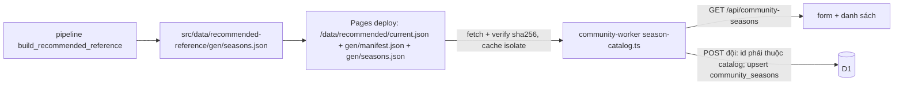

# Đội cộng đồng: user chọn mùa, mùa lấy từ Đội chuẩn

## Overview

Hiện tại: root mở mùa (`POST /api/admin/community-seasons`), đúng một mùa mở, server tự gán đội mới vào mùa mở,
mùa cũ khoá vote + chiến báo. User chơi mùa cũ không đăng được đội cho mùa đó.

Sau thay đổi:
- Danh mục mùa = `seasonOptions` trong `seasons.json` của generation Đội chuẩn đang publish (29 mùa, id
  `sourceSeasonId` như `og-兵演春秋`, `pk-s28`, …, `s1`). Pipeline thêm mùa vào Đội chuẩn → site deploy → Đội
  cộng đồng thấy mùa mới, **không** deploy worker, **không** thao tác admin.
- Form đăng đội: ô chọn mùa bắt buộc, chọn sẵn mùa hiện hành của Đội chuẩn (`defaultSourceSeasonId`, hiện
  `pk-s27` Hán Diễm Trường Minh — do `pipeline/recommended-default-season.json` chốt). Không suy "mới nhất" từ
  thứ tự `seasonOptions` (thứ tự picker nguồn SGSDeck, OG đứng đầu). Cho chọn cả mùa `uncollected` (pk-s21, pk-s15).
- Bỏ khái niệm mùa đóng: mọi mùa nhận đội, vote, chiến báo. Bỏ khối "Mùa đang mở"/"Mở mùa mới" ở `/quan-tri/`.
- Danh sách `/doi-cong-dong/` mặc định lọc mùa hiện hành (`defaultSourceSeasonId`); vẫn có "Tất cả mùa".

## Quyết định đã chốt (anh, 2026-11-14)

| # | Quyết định |
|---|---|
| 1 | Nguồn mùa = danh sách mùa Đội chuẩn; bỏ hẳn UI quản lý mùa trong admin |
| 2 | Bỏ hẳn "mùa đã đóng" (gỡ `closed_at` + unique index) |
| 3 | Ô chọn mùa bắt buộc, chọn sẵn mùa mới nhất → hiện thực bằng mùa **hiện hành** của Đội chuẩn (`pk-s27`), xem Unresolved |
| 4 | Danh sách mặc định mùa mới nhất → như trên |
| 5 | Quy trình: branch `feat/community-team-season-pick`, plan → Astra → Fable → cook `--tdd` → PR |

## Kiến trúc

- Worker đọc catalog lúc chạy từ `siteOrigin(env)` theo đúng chuỗi xác minh frontend đang dùng
  (`current.json` → `manifest.json` khớp `manifestSha256` → `seasons.json` khớp `files["seasons.json"].sha256`).
  Lý do: worker deploy tay (`community-worker-gate.yml` không deploy), bundle lúc build sẽ không tự có mùa mới.
- Bảng `community_seasons` giữ làm đích FK + nhãn cho join/export; hàng được **upsert** từ catalog trong cùng
  batch insert đội. Không phải nguồn danh mục nữa.
- Nhãn: `labelVi = "<displayCode> · <displayNameVi ?? nameRaw>"`, `labelZh = "<displayCode> · <nameRaw>"`
  (cần mã vì tên trùng: pk-s7 và s3 đều "Trận chiến Xích Bích").

## Dữ liệu production (đọc ngày 2026-11-14, `wrangler d1 execute --remote`, chỉ đọc)

- `community_seasons`: 1 dòng `binh-dien-xuan-thu` (mở), 2 đội.
- `battle_reports.season`: 3 dòng, đều `null` → không cần remap chiến báo, nhưng migration vẫn remap theo điều kiện cho đúng.

## Phases

| # | Phase | Status |
|---|-------|--------|
| 1 | [Phase 1: Start](./phase-01-start.md) | Pending |
| 2 | [Phase 2: Worker-routes](./phase-02-worker-routes.md) | Pending |
| 3 | [Phase 3: Frontend](./phase-03-frontend.md) | Pending |
| 4 | [Phase 4: Docs-deploy](./phase-04-docs-deploy.md) | Pending |

## Success Criteria

- [ ] `POST /api/community-teams` với `season` thuộc catalog → 201, đội gắn đúng mùa; mùa ngoài catalog (đã xác nhận bằng refresh thành công) → 400 `invalid_season`; thiếu `season` → 400; catalog không xác nhận được → 503; mùa mới hiện trên isolate sau tối đa 30 s cooldown.
- [ ] Đội mùa cũ (bất kỳ mùa nào) vote + gửi chiến báo được; không còn mã `season_closed` / `season_not_open`.
- [ ] `GET /api/community-seasons` trả đúng thứ tự `seasonOptions`, `current` = `defaultSourceSeasonId`; catalog lỗi/treo mà có cache cũ → dùng cache; không có cache → 503 `season_catalog_unavailable`.
- [ ] Không còn route `POST /api/admin/community-seasons`, khối mùa ở `/quan-tri/`.
- [ ] Migration 0012 trên D1 giả: 2 đội `binh-dien-xuan-thu` → `og-兵演春秋`, không còn `closed_at`/unique index.
- [ ] `npm test` + `npm run typecheck` (community-worker), `npm run test:node`, e2e đội cộng đồng/quản trị xanh.
- [ ] Rollback 0013 đưa DB về dạng worker/frontend cũ đọc được (test); worker mới đọc được schema cũ ≤0011 (test).
- [ ] Production: deploy worker → cổng đường thật qua `tqccl.com` → migrate → merge (Pages); không 5xx trên đọc/vote/chiến báo/export; smoke đăng đội mùa cũ, người khác vote + chiến báo.

## Rủi ro

| Rủi ro | Xử lý |
|---|---|
| Lệch phiên bản Pages/Worker/schema (ma trận Phase 4) | Thứ tự: deploy worker → cổng đường thật → migrate → merge PR (Pages). Migration phá bỏ không chạy trước worker |
| Worker fetch ngược `tqccl.com` bị chặn (same-zone / 1042) | Cổng `curl tqccl.com/api/community-seasons` sau deploy worker, trước migrate; dự phòng `global_fetch_strictly_public` → origin `tqccl.pages.dev` → rollback worker |
| Rollback cần worker/frontend cũ đọc được | Rollback SQL 0013 remap `og-兵演春秋` → `binh-dien-xuan-thu`, đóng mùa khác, dựng lại index; bookmark Time Travel; rollback worker theo version ID đã ghi |
| Site sập/treo/đổi path → không đăng được đội | Deadline 5 s cả chuỗi; cache giữ bản đã xác minh; không có cache → 503 rõ ràng + negative-cache 30 s |
| Isolate khác cache cũ khi mùa mới ra | `findSeason` miss → refresh single-flight (≤ 1 lần / 30 s) rồi mới 400 |
| `sourceSeasonId` đổi giữa các generation | Đội cũ giữ hàng `community_seasons` cũ (nhãn vẫn hiện); chỉ không chọn mới được. Ghi vào docs |
| id có chữ Hán (`og-兵演春秋`) trong query/URL | `URLSearchParams` mã hoá; validate = luật CHECK D1 (ký tự đầu `[a-z0-9]`, ≤ 40) + membership catalog |

## Unresolved

- "Mùa mới nhất" anh chọn: dữ liệu cho thấy mùa mặc định của Đội chuẩn là `pk-s27` (chốt 2026-11-13 trong `pipeline/recommended-default-season.json`), còn `pk-s28` đứng trước trong danh sách nguồn. Plan dùng `pk-s27` (mùa hiện hành, khớp Đội chuẩn). Nếu anh muốn mùa khác làm mặc định → báo lại.
