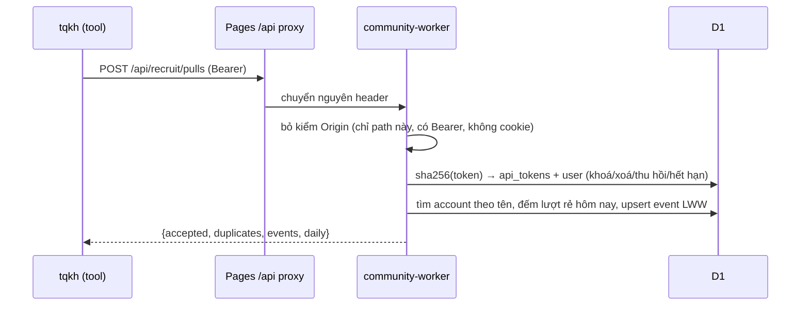

# Token API cá nhân cho Theo dõi chiêu mộ

Trạng thái: PR worker đã mở, UI tách sang nhánh riêng · Chế độ: `/ak:plan --hard --tdd` · Nhánh: `nguyennguyenit/recruit-api-token` (từ `origin/main` 8adc44d) · Chốt với anh Nguyên 2026-11-15.

## Mục tiêu

Tool bên ngoài (`tqccl-auto`, skill `quay-tuong`) ghi lượt quay tướng vào tracker của user qua
`Authorization: Bearer <token>`, không cần trình duyệt/cookie. Xong khi PR mở từ `main`, test worker +
client xanh, docs/changelog cập nhật. Không gộp, không deploy, không migrate remote.

## Quyết định đã chốt (user)

| Câu hỏi | Chốt |
|---|---|
| Ai tạo token | Mọi user đã đăng nhập; token chỉ ghi vào tracker của chính họ |
| Hạn dùng | Người tạo chọn 30 / 90 / 365 ngày / không hạn; mặc định 90 |
| Endpoint | `POST /api/recruit/pulls` gọn cho máy; token KHÔNG dùng được cho `/api/recruit` thô |
| UI | Trên trang Theo dõi chiêu mộ (vi + zh), chỉ khi đã đăng nhập |
| Chống trùng | Mỗi lượt có `key` do tool cấp; gửi lại cùng key → bỏ qua |
| Trần ngày | Vượt 4 lượt rẻ/ngày/tài khoản (gói `danh-tuong-pk`) → 409, không ghi gì của lô |
| UI | Trên trang Theo dõi chiêu mộ (vi + zh). **Đổi 2026-11-15**: tách khỏi PR này — sửa `js/recruit-tracker.js` buộc ghim lại hash trong `site-localization-policy.json` + publish generation. Code UI giữ ở nhánh `nguyennguyenit/recruit-token-ui`, gộp vào lần publish kế tiếp |
| Tài khoản | Khớp chính xác tên (trim, NFC), chưa xoá; không thấy → 404; trùng tên → 409; không tự tạo |
| Tên tướng | Chỉ lưu tên tướng cho lượt 5★; lượt không ra không ghi tên/note |

## Thiết kế

- **Migration `0012_api_tokens.sql`** (0007/0009/0010 đã có chủ ở `rollback/`, 0011 là roster): bảng
  `api_tokens(id, user_id → user on delete cascade, name, token_hash unique, hint, scope check = 'recruit:write',
  created_at, last_used_at, expires_at null, revoked_at null)` + index `(user_id)`. Chỉ thêm bảng.
  Xoá tài khoản: cascade theo FK, cùng chỗ với `recruit_records` ở batch cuối.
- **Token**: `tqccl_pat_` + 32 byte ngẫu nhiên base64url. Lưu SHA-256 hex (token entropy cao, không cần hash chậm),
  `hint` = 4 ký tự cuối để nhận diện trên UI. Trả token thô đúng một lần ở phản hồi tạo.
- **API quản lý** (cookie, kiểm Origin như cũ): `GET /api/tokens` (liệt kê, không có hash),
  `POST /api/tokens {name, expiresInDays: 30|90|365|null}` (tối đa 10 token còn hiệu lực/user → 409, rate `token_create` 20/ngày),
  `DELETE /api/tokens/:id` (đặt `revoked_at`, chỉ token của mình; token người khác → 404).
- **Auth Bearer** (`src/tokens.ts`, `requireToken(c, scope)`): thiếu/sai/thu hồi/hết hạn → 401 `invalid_token`;
  user khoá/đang xoá → 403 `account_blocked` (dùng `isBlocked`). `last_used_at` cập nhật nền ≤ 1 lần/10 phút.
- **Middleware `/api/*`**: chỉ bỏ kiểm Origin khi path = `/api/recruit/pulls`, có `Authorization: Bearer` và
  không có cookie phiên. Browser không tự gửi Bearer nên không mở CSRF. Route `/pulls` chỉ nhận Bearer.
- **`POST /api/recruit/pulls`**: body `{accountName, banner: "danh-tuong-pk", timeZone?, pulls: [{key, at, fiveStar, hero?, heroValueClass?}]}`,
  1–4 lượt. `key` `[A-Za-z0-9_-]{8,64}`, `at` ISO, `hero` bắt buộc khi `fiveStar` (≤ 40 ký tự),
  `heroValueClass` ∈ 6 phân loại của tracker (mặc định "Chưa phân loại"). Mỗi lượt thành một event v2:
  `id = evt_ext_<key>`, `accountId`, `bannerId: danh-tuong-pk`, `date` (theo timeZone), `drawKind: daily`, `pulls: 1`,
  `result: fiveStar|miss`, `heroName`/`heroValueClass` chỉ ở 5★, `note: ""`, `occurredAt = createdAt = at`
  (lượt cùng `at` trong lô +1 ms giữ thứ tự), `updatedAt` = giờ server, `deletedAt: ""`. Key đã tồn tại (kể cả đã xoá
  trên UI) → `duplicates`, không ghi. Đếm lượt rẻ ngày từ event sống của account/ngày đó + lượt mới; > 4 → 409
  `daily_limit`. Dùng chung `enforceQuota` + `UPSERT` của `/api/recruit`. Rate `recruit_token_push` 120/giờ/user.
  Phản hồi `{accepted, duplicates, events: [{key, id, date}], daily: {date, used, limit: 4}, cursor}`.
- **UI**: mục "Token API" trong menu tài khoản/khối đồng bộ khi đã đăng nhập: hộp thoại liệt kê token (tên, đuôi, hạn,
  lần dùng cuối), tạo (tên + hạn), hiện token một lần kèm nút Sao chép, thu hồi có xác nhận. Chuỗi vi + zh.

## Phase (TDD: test đỏ trước, rồi code)

| # | Phase | Test trước | Trạng thái |
|---|---|---|---|
| 1 | Migration + `tokens.ts` + API quản lý + middleware | `test/tokens.test.ts`: tạo trả token 1 lần, DB chỉ có hash, liệt kê không lộ hash, hạn 30/90/365/null + giá trị lạ → 400, trần 10, thu hồi chỉ của mình, cần cookie, cascade khi xoá user | xong (17 test) |
| 2 | `POST /api/recruit/pulls` | `test/recruit-pulls.test.ts`: Bearer hợp lệ ghi event đúng schema (khớp `validEvent` client), không cần Origin; cookie-only → 401; Bearer trên `/api/recruit` → 401; Origin lạ + cookie vẫn 403; token thu hồi/hết hạn/sai → 401; user khoá → 403; account không có/đã xoá → 404, trùng tên → 409; key trùng → duplicates; vượt 4/ngày → 409 không ghi gì; timeZone mặc định HCM đổi ngày đúng quanh 17:00Z, timeZone lạ → 400; 5★ thiếu hero → 400; rate limit. Quota 413 dùng chung `enforceQuota` (đã có test ở `recruit.test.ts`) | xong (25 test) |
| 3 | UI quản lý token (vi + zh) | `tests-js/recruit-tokens.test.mjs` (trạng thái dòng token vi/zh) + kiểm tay Playwright mock API 1280/390 | xong ở nhánh `nguyennguyenit/recruit-token-ui`, chờ publish generation |
| 4 | Docs + changelog + kiểm | — | xong |

Lệnh kiểm: `cd community-worker && npx vitest run && npx tsc --noEmit`; `node --test tests-js/recruit-*.test.mjs` (theo cách repo đang chạy).

## Red-team (tự rà)

- **Lộ token**: chỉ lưu hash; phản hồi tạo có `Cache-Control: no-store` (middleware đã đặt). Không log token.
- **CSRF**: bypass Origin hẹp đúng một path + Bearer + không cookie; route đó không đọc cookie.
- **Leo quyền**: scope cố định `recruit:write`, route khác không đọc Bearer.
- **Đồng bộ client**: event mới có `updatedAt` server; client kéo theo `rev` nên nhận dù đồng hồ lệch. Event dựng phải qua
  `validEvent` của store — test phase 2 import thẳng `normalizeRecruitTrackerState` để kiểm.
- **Rollback**: Worker cũ bỏ qua bảng `api_tokens`; token ngừng chạy, không mất dữ liệu tracker.

## Triển khai (user tự làm sau review Astra → Fable)

1. `cd community-worker && npx wrangler d1 time-travel info tqccl-community` (ghi bookmark) → `npm run db:migrate:remote` (áp `0012`).
2. `npm run deploy` (Worker).
3. Deploy Pages (UI token).

## Bước sau (ngoài PR này → issue)

- `tqccl-auto`: lệnh `tqkh recruit push` gọi `/api/recruit/pulls`, token lưu qua ak-vault.
- Sửa skill `quay-tuong` bước 9 dùng lệnh trên thay relay Chrome.
