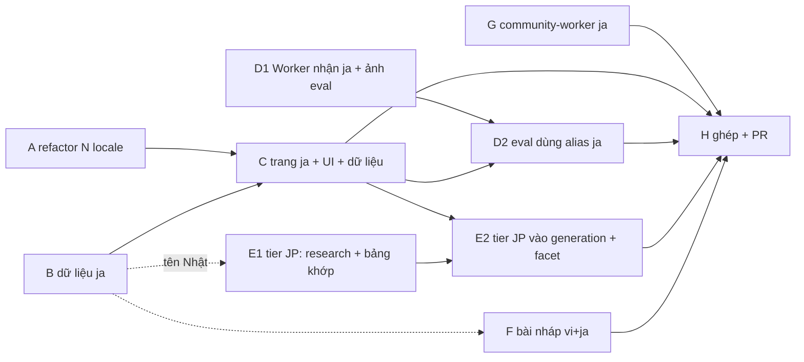

# Bản tiếng Nhật `/ja/` (issue #113, tách từ #10)

Worktree: `/Users/plateau/Project/CamNangTQCCL-ja`, branch `feat/ja-locale` tạo từ `origin/main` tại `993b2d4`. Mỗi phase chạy trên một branch con `feat/ja-locale-<chữ phase>-<slug>` trong worktree riêng, merge vào `feat/ja-locale` theo thứ tự ở mục "Thứ tự ghép"; cuối cùng mở một PR `feat/ja-locale` → `main`. Theo `AGENTS.md`: plan dùng chế độ `--hard --tdd`, cook mặc định `/ak:cook <phase> --tdd`, không push thẳng `main`, phần `worker/`, `community-worker/`, ledger/generation trong `pipeline/` cần review Astra → Fable.

## Hợp đồng (đã chốt với chủ repo, không thu hẹp)

Objective, Done means, Out of scope và Constraints giữ nguyên như brief ngày 2026-11-17 và issue #113. Plan này không bỏ hạng mục nào; hạng mục cần chủ repo quyết thêm nằm ở "Câu hỏi chưa giải".

## Phase

| Phase | Nội dung | Phụ thuộc | Chạy song song với | Effort | Trạng thái |
|---|---|---|---|---:|---|
| [A](phase-01-n-locale-refactor.md) | Refactor N locale, giữ vi/zh trùng byte; công cụ so output | — | B, D, E1, F, G | 10h | done |
| [B](phase-02-ja-data-pipeline.md) | Bảng shinjitai, tên Nhật + trạng thái, dịch máy mô tả, `data/lookup-ja.json` | — | A, D, E1, F, G | 20h | done |
| [C](phase-03-ja-site-pages-ui.md) | Trang `/ja/`, chuỗi UI ja, Tra cứu/đội đọc dữ liệu ja, `docs/ja-gaps.md` | A, B | D, E1, F, G | 36h | done |
| [D](phase-04-worker-ja-alias-eval.md) | D1: Worker nhận `ja` + 2 ảnh eval client Nhật; D2: bộ chấm eval dùng alias tên Nhật | D1: không; D2: C | D1: A, B, C, E1, F, G | 6h | done |
| [E1](phase-05-jp-tier-doi-chuan.md#e1) | Đối chiếu mùa JP↔VN, thu tier JP PK-S27/PK-S26, bảng khớp đội đã review | B (tên Nhật, mềm) | A, B, C, D, F, G | 10h | done |
| [E2](phase-05-jp-tier-doi-chuan.md#e2) | Đưa tier JP vào generation Recommended + facet nguồn JP | C, E1 | F, G | 8h | done |
| [F](phase-06-draft-articles.md) | 3–5 bài vi+ja dạng Markdown nháp trong `plans/` | B (tên Nhật, mềm) | mọi phase | 10h | done |
| [G](phase-07-community-worker-ja.md) | `community-worker` nhận `lang = ja` (cần chủ repo chốt) | quyết định Q1 | mọi phase | 8h | done |
| [H](phase-08-integration-review.md) | Ghép, ghim lại localization, full gate, docs, PR, review độc lập | tất cả | — | 8h | done |

## Thứ tự ghép vào `feat/ja-locale`

A → B → C (cổng so trùng byte vi/zh chạy tại đây) → D → E2 (đã có E1) → G (nếu được duyệt) → F → H. Mỗi lần ghép một phase có sửa file nằm trong `sourceFiles` của `pipeline/site-localization-policy.json`, người ghép **chạy lại** chuỗi ghim hash + publish localization (không merge tay policy, thư mục generation hay `pipeline/team-route-handles.json`); chi tiết ở [phase H](phase-08-integration-review.md#ghim-lại-localization-sau-mỗi-lần-ghép).

## Sở hữu file (tóm tắt; danh sách đủ trong từng phase)

| Phase | Sở hữu |
|---|---|
| A | `js/i18n.js`, `src/lib/locale-routes.ts`, `src/layouts/SiteLayout.astro`, 35 điểm `=== "zh"` và các helper `isZh` trong `js/`, nhóm blog (`src/lib/blog-*.ts`, `src/components/blog/*`), `src/pages/sitemap.xml.ts`, `scripts/verify-astro-dist.mjs`, `scripts/compare-locale-output.mjs` (mới), test i18n mới |
| B | `pipeline/build_lookup_ja.py`, `pipeline/shinjitai.py`, `pipeline/ja-*.json`, `data/lookup-ja.json`, `data/ja-kanji-variants.json`, `tests/test_*ja*.py`, `tests/fixtures/shinjitai-vectors.json`, `docs/ja-lookup-data.md` (tất cả mới) |
| C | Chia C1/C2/C3 rời file (xem phase C). Gồm mọi file còn lại có chuỗi `L(`/`pick(` trong `js/`, `src/`; `src/pages/ja/**` (mới); `src/pages/404.astro`; `src/lib/public-artifact-manifest.mjs`; `public/_headers`, `public/robots.txt`, `public/_redirects`; `pipeline/lookup_route_handles.py`; `pipeline/site_localization.py` (18 biểu thức obligation); `docs/design/so-binh-phap/tokens.json` + `css/styles.css`; `js/shinjitai.js`, `js/locale-name-aliases.js` (mới); `scripts/report-zh-gaps.mjs`, `scripts/report-ja-gaps.mjs`, `docs/ja-gaps.md`; `package.json`; test contract/e2e liên quan |
| D | D1: `worker/src/**`, `worker/test/**` (trừ `eval-score.test.ts`), `worker/eval/images/*-ja-*`, `worker/eval/fixtures/*-ja-*`, `worker/README.md`, `tests-js/worker-locales-parity.test.mjs`. D2 (sau C): `worker/eval/score.ts`, `worker/eval/run-eval.ts`, `worker/test/eval-score.test.ts` |
| E1 | `pipeline/recommended-jp-tiers.json` (mới), báo cáo trong `plans/261117-0153-ja-locale/reports/` |
| E2 | `pipeline/build_recommended_reference.py`, phần nối tham số trong `pipeline/site_localization.py`, `js/recommended-reference-state.js`, `js/team-filter-section.js`, test liên quan (chạy sau C nên không trùng thời gian với C) |
| F | `plans/261117-0153-ja-locale/articles/**` |
| G | `community-worker/**` |
| H | `README.md`, `docs/*.md` evergreen (trừ `docs/ja-gaps.md`, `docs/ja-lookup-data.md`), policy re-pin, generation, `pipeline/team-route-handles.json` |

File dùng chung duy nhất giữa các branch song song là bộ ghim localization (`pipeline/site-localization-policy.json`, `src/data/recommended-reference/**`, `data/website-display.json`, `pipeline/team-route-handles.json`). Branch phase được phép ghim lại để chạy `npm run build` cục bộ, nhưng commit ghim phải là commit cuối, riêng, tên `chore(data): ghim lại hash nguồn`; người ghép bỏ commit đó và chạy lại chuỗi ghim trên kết quả ghép.

## Acceptance criteria (đo được)

1. `node scripts/compare-locale-output.mjs compare` giữa build gốc `993b2d4` và build sau A báo 0 file đổi, 0 file thêm, 0 file mất (ngoài `js/` là mã nguồn được copy thô), sau khi chuẩn hoá ngày build và pin generation.
2. Cùng lệnh, sau C với `--allow-locale ja`: 0 file vi/zh đổi ngoài thẻ `hreflang="ja"`, `og:locale:alternate` `ja_JP`, cụm nút chuyển ngôn ngữ; các file dùng chung đổi có chủ đích (`404.html`, `robots.txt`, `_headers`, `_redirects`) được liệt kê và diff được review.
3. Mọi route có bản `/zh/` có bản `/ja/` cùng đường dẫn; `scripts/verify-astro-dist.mjs` kiểm `<html lang>`, bộ hreflang `vi`/`zh-Hans`/`ja`/`x-default` cho ba locale; sitemap có `3 × (2869 + số trang mùa)` URL thay vì `2 × (…)` (`tests-js/astro-dist-contract.test.mjs:1030`, `:1163`).
4. `grep` không còn `=== "zh"`/`!== "zh"`, `otherLocale`, `BlogLocale`, kiểu `"vi" | "zh"` trong `js/`, `src/`, `scripts/`, `worker/src/`; test tĩnh khẳng định mọi lời gọi `L(`/`pick(` có đúng `SITE_LOCALES.length` biến thể.
5. Mọi trang riêng `/ja/tra-cuu/<nhóm>/<slug>/` hiện tên Nhật, tên gốc chữ Hán, nhãn trạng thái tên (`verified`/`derived`); mô tả dịch máy có nhãn 機械翻訳 và dòng "数値は中国大陸版に基づく"; mục thiếu bản dịch hiện dòng báo thiếu; `npm run verify` chạy `report-ja-gaps --check` xanh.
6. Worker: `explainSubstitute` nhận `locale: "ja"` và trả tiếng Nhật; mode đọc ảnh nhận `locale` tuỳ chọn; unit test bộ khớp alias tên Nhật xanh; `worker/eval/images/` có 2 file `.webp` client Nhật đã che tên + 2 fixture.
7. Đội chuẩn PK-S27 và PK-S26 có hàng mang tier nguồn JP, chỉ từ bảng khớp đã review; facet nguồn JP đếm đúng theo mùa (test đơn vị + e2e).
8. 3–5 cặp bài vi+ja Markdown nháp trong `plans/261117-0153-ja-locale/articles/`, không publish.
9. `npm run check`, `npm run build`, `npm run test:dist`, `npm run verify`, `npm run test:node`, `npm run test:e2e`, `python3 -m unittest discover -s tests`, `(cd worker && npm ci && npm test && npm run typecheck)`, `(cd mcp-worker && npm ci && npm run check:repository)` xanh; PR mở, CI xanh, review độc lập không còn lỗi chặn.

## Rủi ro chính

Chi tiết và cách giảm ở từng phase; tổng hợp ở [phase H](phase-08-integration-review.md#rủi-ro-tổng-hợp). Ba rủi ro cao nhất: (1) sửa ~60 file đang bị policy localization ghim hash buộc publish lại generation sau mỗi lần ghép; (2) `community-worker` và D1 chặn `lang = ja` bằng `CHECK (lang in ('vi','zh'))` nên mọi thao tác ghi cộng đồng/blog ở `/ja/` sẽ lỗi 400 nếu không làm phase G; (3) đánh số mùa JP khác VN, khớp tier JP sai mùa sẽ đưa số liệu sai lên Đội chuẩn.

## Ước lượng số trang

Mỗi locale hiện có khoảng 2.869 URL trong sitemap cộng tối đa 28 trang mùa, cộng trang `noindex` (Chiến báo, Đội của tôi, Quản trị), danh sách blog và RSS. `/ja/` thêm khoảng **2.900 trang HTML** (tăng khoảng 50%, từ khoảng 5.800 lên khoảng 8.700). Thời gian `astro build`, verifier và `test:dist` dự kiến tăng 40–50% phần dựng/đọc trang; e2e chỉ thêm spec `ja-locale` (vài phút). Phase A đo baseline thật (`time npm run build`, `time npm run verify`) để H so sánh.

## Quyết định đã chốt (2026-11-17, sau khi lập plan)

- **Tier JP PK-S27 tách sang issue #115.** Server Nhật mở 漢焔不滅 ngày 21/11/2026, chưa có bài tier. Acceptance 7 và phase E chỉ còn **PK-S26** (Kazten 時代の英雄, 24 đội). Dữ liệu server thử nghiệm S27 chỉ dùng cho tên Nhật và bài viết. Ánh xạ mùa: JP S25「時代の英雄」= VN PK-S26; JP S26「兵演春秋」= Binh Diễn Xuân Thu; JP「漢焔不滅」= VN PK-S27. Nguồn: `plans/reports/researcher-261117-0153-jp-tier-sources.md`, `plans/reports/jp-tier-teams-261117.json`.
- **Q1 → G-A.** Viết migration dựng lại 6 bảng cho phép `ja` và cho `community-worker` nhận `ja`; test trên D1 local; **không áp dụng lên production** (chủ repo áp migration và deploy community-worker trước khi merge site).
- **Q2.** Tier JP hiện trên cả vi/zh/ja, là một giá trị mới "JP" trong facet nguồn hiện có (không thêm khóa facet mới).
- **Q6.** Chủ repo đã gửi 2 ảnh chiến báo client Nhật; ảnh 1 đã che tên tài khoản. Đã commit sẵn ở `worker/eval/images/battle-ja-1.webp`, `battle-ja-2.webp`; phase D viết fixture.
- **Eval AI thật** không chạy được lần này (không có khóa trên máy): chỉ thêm ảnh + fixture + unit test bộ khớp.
- **Không dùng Hensei Kobo** làm nguồn tên (điều khoản cấm dùng thương mại, cần đăng nhập).

Các câu còn lại xem [phase H](phase-08-integration-review.md#câu-hỏi-chưa-giải); người thực thi tự quyết trong phạm vi hợp đồng và ghi lý do.
